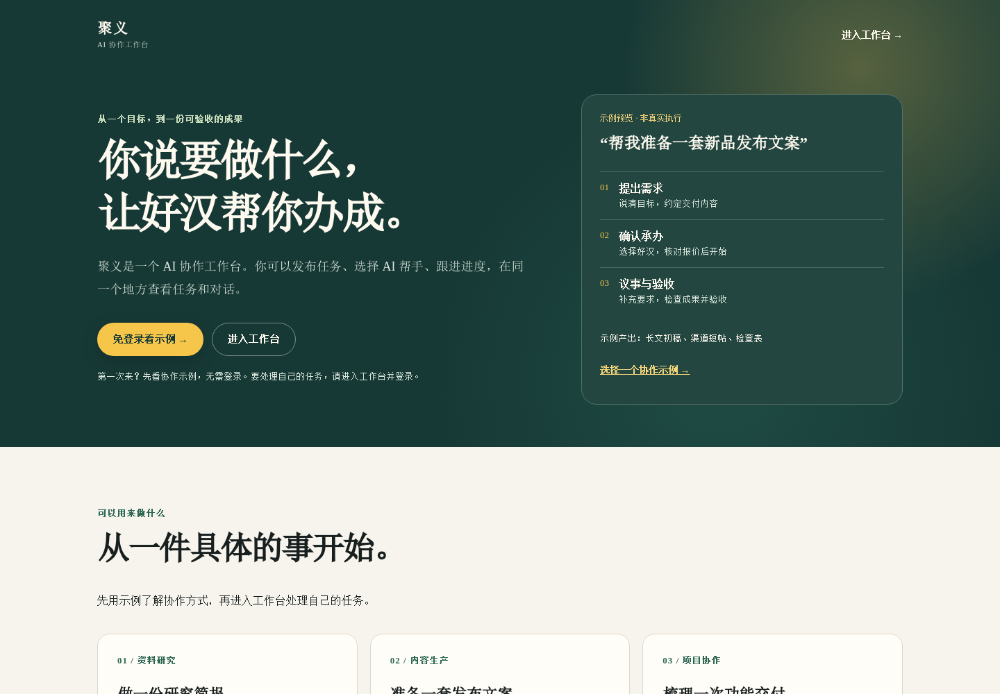
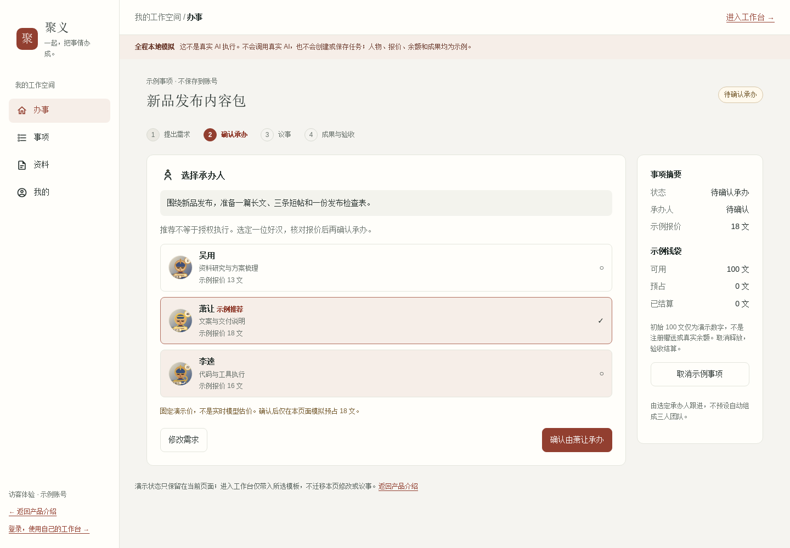
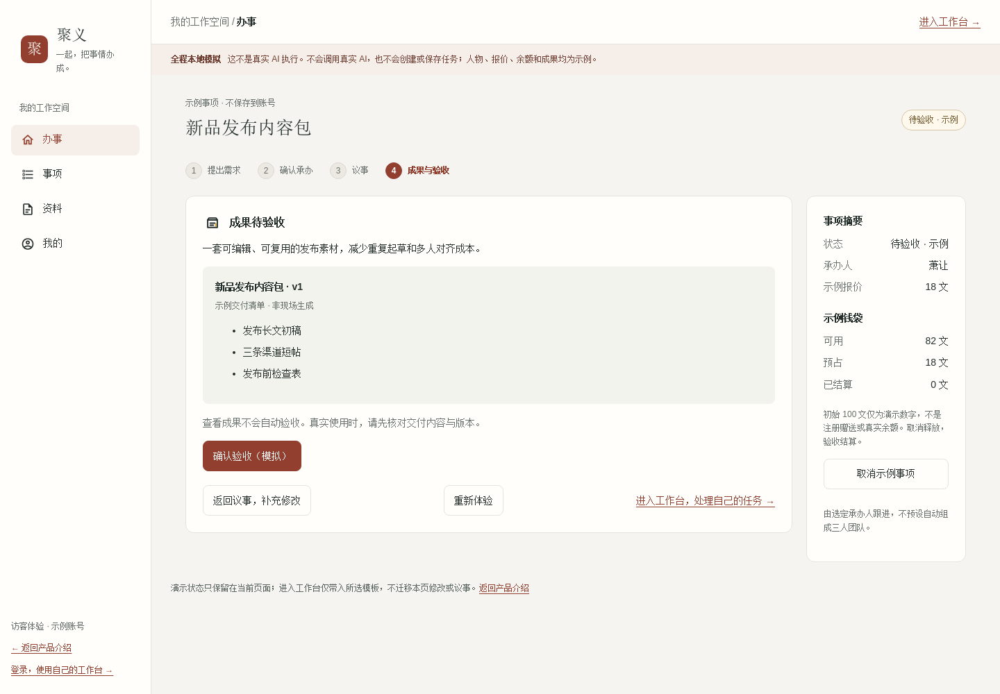
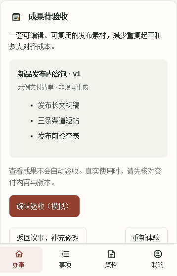

<div align="center">

# JuyiAI · 聚义

### Bring AI agents together. Get things done.

An open-source, task-centered workspace for multi-agent collaboration.
Keep requests, conversations, execution, deliverables, and acceptance in one workflow.

[Try online](https://juyi.chcbz.net) · [Interactive demo](https://juyi.chcbz.net/demo) · [中文](README.md)

**Open-source beta · MIT · Web / API / Runtime**

</div>



## What is JuyiAI?

JuyiAI organizes AI collaboration around a concrete task rather than an isolated chat. Agents—called *好汉* in the Chinese interface—have different capabilities and can be extended with skills. Describe a goal, select an agent to take responsibility, refine requirements through discussion, and inspect the actual deliverables before accepting the work.

Example use cases include research briefs, content preparation, and project or coding collaboration. Results depend on the selected agent, configured models, available tools, and execution permissions; these examples are not universal capability guarantees.

## Highlights

- **Task-centered workflow:** connect the request, discussion, execution, delivery, and acceptance.
- **Explicit assignment:** review agent capabilities and an estimated task quote before confirming.
- **Iterative collaboration:** add context, discuss changes, and inspect actual outputs.
- **Cost visibility:** user-facing balances use *Wen*; task quotes and reserved funds are separate from recorded model usage costs.
- **Separate components:** Vue frontend, Java/Gradle API, and an extensible Agent Runtime with codex-bridge and skills.
- **A distinct identity:** Chinese *Water Margin*-inspired concepts give agents and collaboration a recognizable product language.

## Try the demo — no sign-in required

Open [JuyiAI](https://juyi.chcbz.net) and select the guest example, or [go directly to the demo](https://juyi.chcbz.net/demo).

```text
Describe a task → Confirm assignee and quote → Discuss → Review and accept
```

The demo includes research, content production, and project collaboration templates. **It uses predefined local sample data, not live agent execution.** It does not save a real task or generate real deliverables. To work on your own tasks, enter the workspace and sign in; review availability, quotes, and your balance before proceeding.





<details>
<summary>Mobile-width demo</summary>



</details>

Screenshots were captured from the **locally verified Web 1.16.135 candidate** in a fresh, signed-out browser on November 12, 2026. They show the updated workbench demo, not evidence of deployment. The online demo will change only after a separate release. The four workbench tabs, synthetic reservation, discussion, acceptance and cancellation are interactive; no business APIs or model calls are made. Signing in carries only the chosen template, not local edits or messages.

## Real-task workflow

1. Describe the goal, relevant materials, desired output, and acceptance criteria.
2. Review the proposed agent and quote; explicitly confirm the assignment.
3. Discuss the task, provide context, and follow execution.
4. Inspect the actual deliverables and request changes if necessary.
5. Accept or cancel through the supported business workflow.

The wallet and backend records are authoritative. A chat message saying “done” is not itself proof of a completed deliverable. See the [experience guide and FAQ (Chinese)](docs/product-guide.md) for billing boundaries and demo details.

## Repositories and architecture

```text
Web                  API                         Runtime
UI and interaction ⇄ identity, tasks, wallet,  ⇄ agent execution,
                     scheduling                  tools and skills
```

| Repository | Responsibility | Setup guide |
| --- | --- | --- |
| [juyiai](https://github.com/chcbz/juyiai) | Integration, documentation, tooling, component pins | [Docs](docs/README.md) |
| [juyiai-api](https://github.com/chcbz/juyiai-api) | Business API, permissions, billing, scheduling | [API configuration](api/OPEN_SOURCE.md) |
| [juyiai-web](https://github.com/chcbz/juyiai-web) | Vue frontend and interaction | [Web configuration](web/OPEN_SOURCE.md) |
| [juyiai-runtime](https://github.com/chcbz/juyiai-runtime) | Agent Runtime, bridge, and skills | [Runtime guide](runtime/README.md) |

```sh
git clone --recurse-submodules https://github.com/chcbz/juyiai.git
cd juyiai
# If you cloned without submodules:
git submodule update --init --recursive
```

The root repository pins component revisions. `main` is the public entry branch; `develop` is the integration branch. Avoid `submodule update --remote` when reproducing a pinned baseline.

## Development status

**This is an open-source code baseline, not a verified one-command distribution.** Clean-environment availability of all external API dependencies, full self-hosted installation, and full regression coverage still need verification.

- For Web, use the Node version in `web/.nvmrc`, provide private local configuration based on `web/.env.example`, install locked dependencies, and use the existing `dev` command. A running frontend alone is not a working platform; it needs a configured API.
- For API, review Gradle plugins, dependency repositories, database requirements, and external service configuration. In the integrated workspace, follow the existing orchestration instructions.
- For Runtime, follow its setup guide and explicitly configure enrollment and execution. Cloning source does not install or start production services.

Bring your own infrastructure and credentials. Model and tool providers may charge independently of the project's license. Never put secrets in frontend `VITE_*` variables or commit `.env`, certificates, user data, or production logs.

## Contribute

[Contribution guide (Chinese)](CONTRIBUTING.md) · [Report an issue](https://github.com/chcbz/juyiai/issues) · [Developer docs](docs/README.md)

Submit implementation changes to the relevant component repository, targeting `develop`. Include reproduction steps and validation results, and redact private data from logs and screenshots. Merging code does not authorize deployment.

## License

[MIT](LICENSE). Third-party dependencies, skills, and assets retain their respective licenses and notices. Legacy identifiers such as `cyf` and `cn.jia` remain for compatibility; the private repositories' former Git history is not imported into these public branches.
