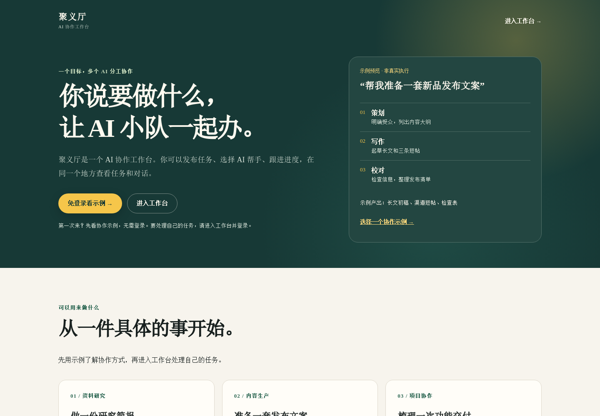
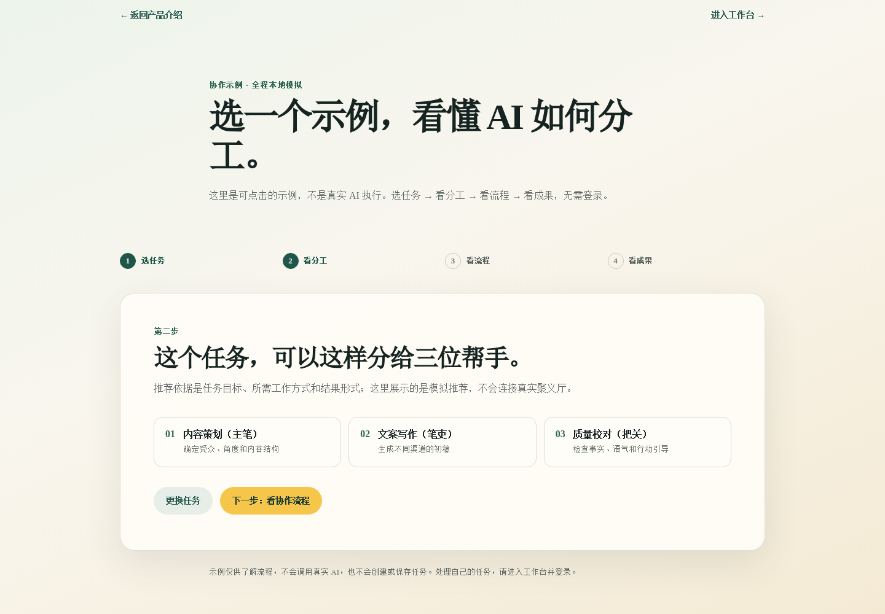
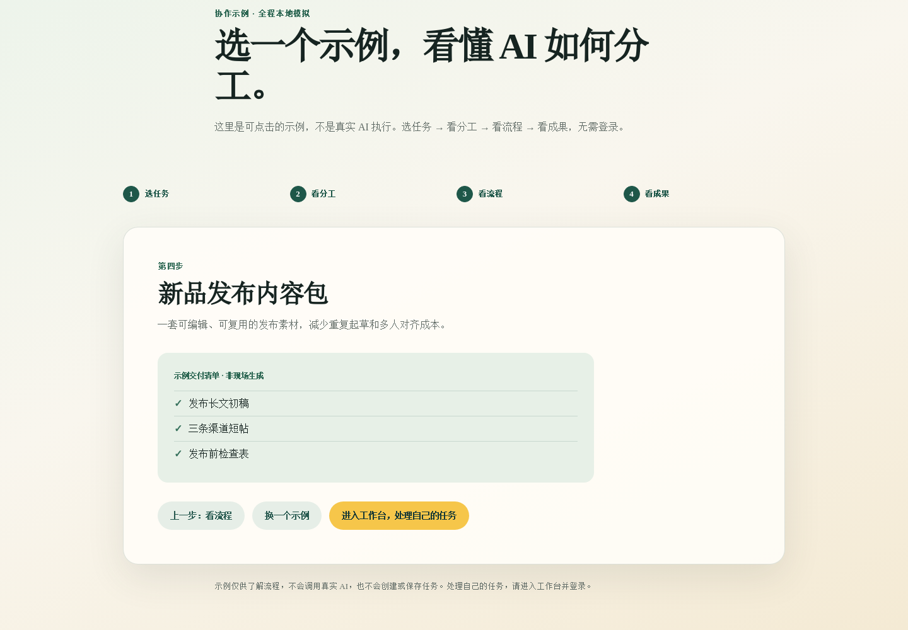
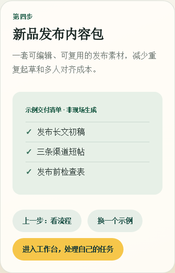

<div align="center">

# 聚义 JuyiAI

### 让 AI 各展所长，把事情办成。

以事项为中心的开源多 Agent 协作工作台。
从提出需求、选择承办人，到议事、执行、交付与验收，让协作不止停留在聊天里。

[在线体验](https://juyi.chcbz.net) · [免登录 Demo](https://juyi.chcbz.net/demo) · [使用指南](docs/product-guide.md) · [English](README.en.md)

**开源内测 · MIT · Web / API / Runtime**

</div>



> 截图来自 2026-11-12 的公开页面。线上部分界面仍显示旧名称“聚义厅”；项目品牌已统一为“聚义 JuyiAI”。在线站点与本仓固定源码版本可能不同。

## 聚义是什么？

聚义把 AI Agent 称为“好汉”：各有擅长的工作，也可以通过技能扩展能力。你围绕一件具体的事提出目标，选择承办好汉，通过持续议事推进工作，最终查看成果并验收。

它适合希望把**需求、对话、执行和交付放在同一条流程里**的个人与团队，也为开发者提供独立的前端、业务 API 和 Agent Runtime 源码。

| 你想做的事 | 可以怎样开始 |
| --- | --- |
| 资料研究 | 给出研究问题、范围和材料，约定简报、对比表或来源清单 |
| 内容生产 | 明确受众、渠道与风格，逐步完善文案和交付清单 |
| 项目与代码协作 | 说明需求、约束和验收标准，跟进实现与交付 |

这些是应用场景，不是对每个模型、技能或部署环境的能力保证。具体工具、模型与执行权限取决于所选 Agent 的配置。

## 为什么用聚义？

- **事项驱动，而不是只有聊天记录**：围绕目标组织讨论、执行与成果，保留验收环节。
- **选择合适的承办人**：查看 Agent 能力，结合推荐与费用报价，显式确认承办。
- **讨论与交付连起来**：通过议事补充资料、调整要求，再查看实际交付结果。
- **费用可见、过程可追溯**：用户余额以“文”展示；事项报价、费用预占与实际模型成本分开记录。
- **技能与 Runtime 可扩展**：前后端和执行端独立维护，可按部署环境配置模型、工具与技能。
- **有自己的产品风格**：用“好汉、议事、承办”等概念组织 AI 协作，而不是再做一个空白聊天框。

## 在线 Demo

**[打开聚义 →](https://juyi.chcbz.net)**，点击“免登录看示例”，按四步体验：

```text
选任务 → 看分工 → 看流程 → 看成果
```

提供资料研究、内容生产、项目协作三个示例。无需账号，不调用真实 Agent，也不会把示例保存为你的事项。**Demo 是可交互的本地模拟，不是实时执行效果或真实成果证明。**

要处理自己的事项，请点击“进入工作台”并登录；使用前查看当前可用 Agent、报价和余额。模型与工具调用可能产生费用。

### 看分工



### 看成果



<details>
<summary>移动端示例</summary>



</details>

截图均使用全新、未登录的浏览器上下文采集，不包含用户私有会话。来源与复现方式见[使用指南](docs/product-guide.md#截图来源与复现)。

## 实际使用流程

```text
提出需求 → 推荐 / 选择承办人 → 查看报价并确认
                                      ↓
验收 / 取消 ← 查看成果与反馈 ← 议事与执行
```

1. **把目标说清楚**：说明要做什么、有哪些资料、期望怎样交付。
2. **确认承办**：查看候选好汉、报价和可用余额，再确认开始。
3. **跟进议事**：补充上下文、查看回复与进展，必要时提出修改。
4. **检查成果**：核对实际交付内容，不把聊天中的完成声明当成成果。
5. **验收或取消**：通过业务入口结束事项；钱包与状态以服务端结果为准。

[详细体验指南与常见问题 →](docs/product-guide.md)

## 源码与架构

```text
Web                 API                        Runtime
交互与展示   ⇄   身份 / 事项 / 钱包 / 调度   ⇄   Agent 执行 / 工具 / 技能
```

| 仓库 | 职责 | 开发入口 |
| --- | --- | --- |
| [juyiai](https://github.com/chcbz/juyiai) | 产品入口、跨仓文档、工具和组件版本引用 | [文档导航](docs/README.md) |
| [juyiai-api](https://github.com/chcbz/juyiai-api) | Java / Gradle 后端，业务、权限、费用与调度 | [API 配置](api/OPEN_SOURCE.md) |
| [juyiai-web](https://github.com/chcbz/juyiai-web) | Vue 前端、页面与交互 | [Web 配置](web/OPEN_SOURCE.md) |
| [juyiai-runtime](https://github.com/chcbz/juyiai-runtime) | Agent Runtime、codex-bridge 与技能 | [Runtime 指南](runtime/README.md) |

### 获取源码

```sh
git clone --recurse-submodules https://github.com/chcbz/juyiai.git
cd juyiai
# 已克隆但还没有组件：
git submodule update --init --recursive
```

根仓 gitlink 固定集成版本，`main` 为对外入口，`develop` 用于开发集成。不要用 `submodule update --remote` 代替获取固定版本。

### 本地开发从哪里开始？

1. 阅读对应组件的配置入口，准备自己的服务配置和模型凭证。
2. 前端使用 `web/.nvmrc` 指定的 Node 版本，复制 `web/.env.example` 为本地配置后，按锁文件安装依赖并运行现有 `dev` 命令。需要可访问的 API；仅启动前端不等于整个平台可用。
3. 后端先核对 Gradle 插件、依赖仓、数据库和外部服务配置；集成工作区沿用[现有编排入口](ops/orchestration/README.md)。
4. Runtime 按其说明配置接入与执行环境。安装或启动服务是单独的部署操作，不是克隆仓库的一部分。

**当前开源交付是源码基线，不是已验证的一键安装发行版。** 干净环境下 API 全部外部依赖的公开可用性、完整自托管安装与全量回归仍需验证。不要直接将历史内部部署命令用于自己的生产环境。

## 文档与参与

- [产品体验 / Demo / FAQ](docs/product-guide.md)
- [开发者文档导航](docs/README.md)
- [组件与职责地图](docs/codex-project-map.md)
- [功能与实现定位](docs/juyiting-feature-guide.md)
- [贡献指南](CONTRIBUTING.md)
- [反馈问题](https://github.com/chcbz/juyiai/issues)

欢迎提交可复现的问题、改进建议和 Pull Request。业务代码改动请提交到对应组件仓；跨组件问题可以先在根仓交流。

## 安全与许可证

请勿提交 `.env`、密钥、证书、用户数据或生产日志。前端 `VITE_*` 配置会进入浏览器，不得放置模型密钥。自行部署需要你提供基础设施和凭证，第三方模型及工具可能收费。

原项目技术标识 `cyf`、`cn.jia` 与部分安装路径为兼容现有代码保留；历史规格不代表当前公开版本已通过验收。公开分支不携带原私有仓库的提交历史。

[MIT License](LICENSE)。第三方依赖、技能与素材遵循各自许可证和版权声明。
