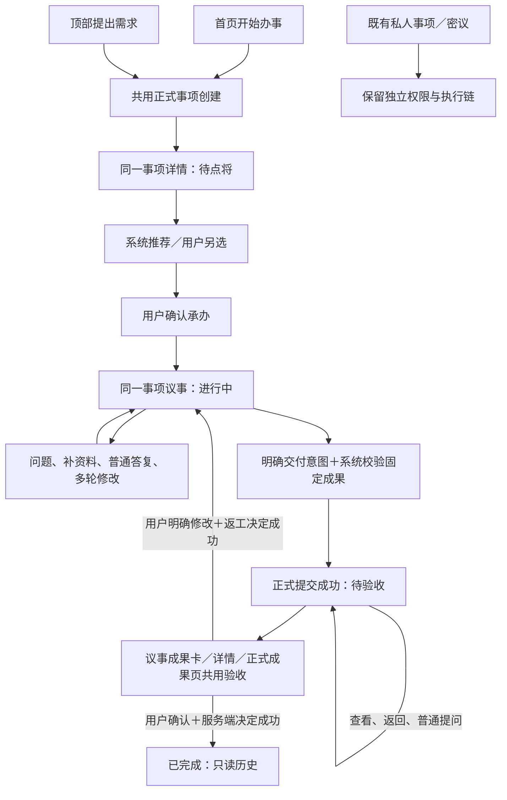
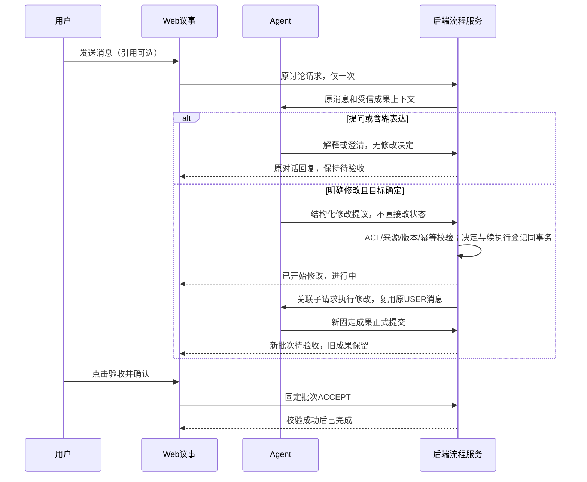

> **现行适用范围（2026-11-07）：** 本文是[所属专题](../spec.md)的细则，不独立定义发布/角色/DFX规则；共用[统一开发约束](../../architecture-convergence/development-principles.md)。旧日期候选/测试/安装仅代表当时范围，未核实部分不改成今日完成。业务协议/冻结输入不因文档整理改写。

# 聚义厅体验优化详细设计

> **2026-11-16 NF-1现行增量：** 原文件预览、旧执行入口接替与状态反馈按[本文NF-1](#nf-1)实施；同范围旧parts/转换要求被取代。正文其他业务规则不变。本轮仅设计/原型，未宣称产品实现或部署。

> 2026-10-23整理：本文保留原日期源码/设计定位，不按旧排期执行、不从“待实现”文字推断当前代码。当前范围与交互见 [spec.md](spec.md)，剩余工作见 [tasks.md](tasks.md)，后续成果多选及历史稿验收见 [最新详设](../../juyiting-external-commission-mvp/design.md#selected-output-acceptance)。发布/验收独立查证。

> 2026-10-18代码级补充：[后端/合同/持久化](code-backend-design.md)、[Web逐文件交互](code-frontend-design.md)、[代码实施与测试清单](code-execution-checklist.md)。下文10月17日的“待收口”事项已在这些文档中给出目标方法/合同；E01现在是按设计实现codec/schema与验证，不再重新选择架构。新增设计不代表现行接口。

初始日期：2026-10-17；本轮界面/源码复核：2026-10-18。Owner：当前任务负责人（沿用 `REQUIREMENT-EXECUTION-20261016` handoff）。状态：**实施设计，尚未实现/验收/发布**。

关联：[完整变更方案](spec.md)、[执行计划](tasks.md)、[生产全流程核对](full-flow-recheck.md)。页面、卡片、控件的唯一最新规格在 `web/prototypes/juyiting/specs/prototype-spec.md`（仓库根相对路径）；本文件描述本次如何改，不复制第二套原型规格。

## 1. 基线、范围与设计边界

- 依据2026-10-17已完成的生产观察和授权写链；正式事项466文本创建、点将、多轮修改、人工验收及完成回读通过。顶部私人入口在最后观察时仍QUEUED，不能据此认定永久卡死。
- 本次文档整理本地HEAD仍为根 `aae93c074960580942112707e9518d831a0ff0af`、Web `6fbdb6618b1132316a95db87cca9402de83138e8`、API `b76a1d0aeda572767a6d4734d050121d985bd9c9`；tree及此前fetch记录见 `baseline.json`。本次未重新fetch、登录生产或运行应用，不将这份文档日期当新线上核验。
- 19页纳入范围：9页明确改动、8页共享复核、2页证据不足；追踪变更方案A01–A09/B01–B08。
- 正式事项仅单承办、一个必需工作项；多成果文件不等于多Agent聚合。身份、资料可见范围、计费、租约及终态约束沿用服务端权威。
- 不做无Agent注册引导、账户系统、公议新入口、旧私人数据批量迁移、Runtime接入重构或新取消/退款能力。
- 接口标准固定为 `api/docs/interface-standard.md` **v1.2（2026-10-14）**。下文逻辑字段不是已上线DTO声明；新增/变更wire须补既有接口目录与schema，全部实际生产者/消费者同步，禁止长期双轨。

## 2. 整体结构与责任



| 层 | 责任 | 不允许承担的责任 |
|---|---|---|
| 页面/共享控件 | 表达真实阶段、草稿/预览/选择、明确操作意图 | 凭消息结束、文件数量或计时器修改业务状态 |
| Web composable | 同一事项上下文、请求关联、取消过期观察、共用投影/决定入口 | 用上次Agent、其他话头回执、字符串文案推断权限 |
| API业务服务 | 创建、指派、提交、决定、返工的权限/版本/幂等和事务 | 将用户普通聊天当验收；公开旧私人数据 |
| Agent/执行服务 | 已授权请求执行、明确交付候选及固定来源 | 自行代用户通过验收；绕过必需工作与有效租约 |
| 读模型 | 根事项＋当前交付＋未决操作的关联事实和合法动作 | 将请求完成等同于事项完成 |

## 3. 用户状态投影（B03）

四主阶段仅为投影，不新增一套持久业务状态机。归一化投影由共享逻辑生成，首页、列表、详情、议事、消息聚合共用；API仍裁定每次写入。优先级：**权限/数据完整性 → 原操作未决限制 → 根终态 → 当前有效交付 → 指派/执行事实**。未决限制是覆盖提示，不伪造新的主阶段。

| 权威事实 | 用户显示 | 合法操作/限制 |
|---|---|---|
| 尚未创建，仅有本地或服务端草稿 | 草稿，不进四主阶段计数 | 编辑、保存、开始办事；创建未知先查原意图 |
| 已保存、无有效指派 | 待点将 | 推荐/另选/确认；取消仅按资格 |
| 已指派未接手、排队或执行中 | 进行中＋真实原因 | 继续议事；不新增“待开工”主标签 |
| 待澄清、等待授权、可恢复阻塞 | 进行中＋问题/原因 | 同议事回答或实际允许的恢复；不自动重试 |
| 当前有效正式提交、未决定、无已成功返工 | 待验收 | 查看成果并验收、继续议事；后者只导航 |
| 旧提交已要求修改，新轮次尚无有效交付 | 进行中 | 同议事修改，旧成果保留历史但无验收入口 |
| 根完成且决定/交付关联有效 | 已完成 | 最终成果、历史议事只读 |
| 根failed / cancelled / archived | 失败／已取消／已归档的历史标记 | 次级历史/异常可查回；不混入四主阶段，不默认可恢复 |
| 创建/提交/验收/返工回执UNKNOWN | 保留最后已确认阶段＋“正在核对本次操作” | 冻结冲突写入，查询同一操作；不更换幂等键重发 |
| 未知枚举、来源缺失、根与交付矛盾 | 状态待核对及安全说明 | 保留已知事实，只读/刷新，不落入默认进行中 |
| 401/403或身份切换 | 登录/无权访问提示 | 隔离缓存和订阅；不得用旧数据继续操作 |

筛选和计数以同一权限域及查询语义计算，不以当前分页条数代替总数。无权限数据不展示；可见但事实冲突的记录不能悄悄消失，留核对入口。归档标记若是个人整理而非根终态，仅影响个人视图，不覆盖正式阶段。

### 状态转换与触发

| 转换 | 触发者 | 成功条件与失败行为 |
|---|---|---|
| 草稿→待点将 | 用户点开始办事；API保存 | 原子保存需求/资料引用；成功取同一taskId，未知查询原创建意图 |
| 待点将→进行中 | 用户确认Agent；系统接续首轮 | 权限、候选、事项版本有效且指派持久化；派发失败在原事项恢复，不重建 |
| 进行中→待验收 | Agent明确交付；系统提交 | 固定来源/版本、有效权限和必需工作项、无未决修改冲突；提交失败保留普通成果及错误 |
| 待验收→进行中 | 用户发送明确修改意图 | 对当前交付的要求修改决定成功；新执行失败仍保留决定和待恢复原因，不能恢复旧验收按钮 |
| 待验收→已完成 | 用户点击确认验收 | 服务端决定与完成事实成功；未知保留核对，不能前端先完成 |
| 可取消阶段→取消历史 | 用户取消 | 仅真实允许动作成功，不代表Provider停止或已退款 |

## 4. 创建、指派与议事连续性（B01/B02/B04）

1. 首页与顶部编辑器复用 `useHallRequirementCreate` 的正式创建服务。标题/正文/固定资料引用进入同一意图；保存草稿不调用Agent，开始办事才创建正式事项。
2. 顶部入口不再为**新正式需求**默认走PRIVATE_CASE。旧私人草稿/事项保持原入口与原scope；用户打开历史记录按来源分流，不静默改成TASK或改变可见范围。已有草稿提交策略在合同收口时显式定义，不把尚未提交的私人草稿自动公开。
3. 创建成功立即进入同一详情待点将；推荐请求失败不影响已保存事实。选择候选只更新选择，用户确认才调用既有point-and-deliberate链；费用/授权确认如实际需要仍保留，不能以少分支为由绕过。
4. 确认时绑定taskId、当前指派/事项版本和显式Agent ID；取消推荐或返回不撤销事项。无Agent时显示真实空态与已有名册入口，不扩建新手流程。
5. 话头属于事项/Agent作用域，新话头不新建事项。草稿按身份＋scope＋事项/Agent＋话头隔离；发送成功才清草稿，失败保留。
6. 澄清回答沿pendingQuestion与版本关联；普通提问不拒收。不提供“引用修改”按钮；修改直接在议事输入。发送明确修改要求由Agent提议，后端从原消息快照绑定固定交付；模糊自然语言先在同议事澄清，不由关键词猜测执行破坏性决定。
7. 话头切换不丢交付入口：若当前话头无对应消息，展示同一权威交付集合的紧凑引用卡，仍一个批次一个入口，不复制或重新提交交付。

## 5. 正式提交、验收与返工（B05/B06）

### 5.1 现有能力与拟改合同

现行 `ChatSelectedOutputFinalizationService` 在人工点击后submit→accept，生产已验证；这是已有的一键验收，不是稳定待验收。目标是将准备/正式提交和用户决定解耦，不能只把按钮移进聊天。

| 业务动作 | 现有落点（2026-10-17定向源码） | 本次设计 |
|---|---|---|
| 正式提交/列表 | `AgentTaskFormalDeliveryController` 的 `/agent/tasks/{taskId}/formal-deliveries` POST/GET | 复用正式交付服务；自动提交由受信服务编排，不让浏览器伪造leaseToken |
| 决定 | `.../formal-deliveries/{deliveryId}/decision` POST | 复用验收/要求修改事务，所有UI入口调用同一决定入口 |
| 返工执行 | `.../formal-deliveries/{deliveryId}/rework-executions` POST | 关联已成功修改决定与原话头，保持原版本链，可恢复创建失败 |
| 选中聊天成果编排 | `/agent/tasks/{taskId}/finalizations`、`ChatSelectedOutputFinalizationService` | 拆除提交后无独立决定的自动接续；保留固定文本转成果、原操作核对及恢复能力 |
| Web成果入口 | `BountyDiscussionPanel`、`BountyAcceptancePanel`、`BountyExecutionOutputs`、`bountyOutputCatalog` | 共用固定成果目录和决定动作；不按页面各造验收服务 |

以上路径为现有路径定位，**不是新wire已冻结**。最终finalization提交语义、操作查询DTO、Agent交付事件承接点已由2026-10-18代码级后端详设B2–B5确定；E01按其补入既有接口目录、codec和测试；不创建猜测URL或复用旧“确认”接口自动通过。受信提交不得借用用户验收权限冒充Agent租约。

### 5.2 固定批次与操作输入

需验证的逻辑关联：认证tenant/client/owner、taskId/expectedTaskVersion、指派版本、workItem/run与有效执行授权、conversation/request/message固定来源、artifactId/artifactVersion/contentHash、deliveryId/expectedDeliveryVersion、决定版本及幂等意图。字段名称以既有DTO为准，缺少的才设计扩展；认证主体不能信任body。

- 文本必须固化所选消息版本及替换链，不能以“最后一条消息”动态求值；文件必须固定版本与摘要。REPLACE关系保留旧历史，不覆盖已经验收的批次。
- 自动提交触发为权威交付意图成功落库后的服务编排；普通回复、单个媒体上传、request completed均不触发。重投按同一来源/版本去重。
- 提交成功后必须可刷新读到submitted/current delivery，且没有用户决定时不会进入ACCEPTED/completed。只读访问不创建交付。
- 验收确认冻结整个批次及版本；预览仅打开文件，不更换冻结集合。确认前后都重新检查权限、当前批次、必需工作项与根终态。
- 同一批次并发验收与修改仅允许一个胜出；版本冲突刷新权威事实，不自动改成对新批次的决定。重复同一意图返回原结果；同键不同载荷不得当新请求。
- 交付已要求修改但返工执行未成功：保留决定与恢复点，只恢复同一返工意图；不能再接受旧交付，也不能向用户提示新轮次已执行。
- 返工产生新固定批次，再进入待验收。此前普通聊天修改成功不算本轮“拒收→返工→重验”验收证据。

### 5.3 用户界面

- 详情待验收仅“查看成果并验收 / 继续议事”。查看进入同一交付确认；继续议事只导航。
- 议事不增加固定待验收大区域，顶部事项操作栏提供唯一“查看并验收”入口，范围是整批，仅资格满足时显示。消息区与所有单文件成果卡无验收按钮；弹窗显示本批数量和全部成果，二次确认后提交。
- 成果卡只保留预览，验收不属于单条消息或文件卡；移除卡片下载/保存到工作空间，但保留独立预览/资料下载及文字片段保存。
- 独立正式成果页保留历史和异常核对，共用决定合同。完成后展示最终成果或真实读取失败，不同时提示“等待结果”。

## 6. 页面与共享组件实施设计（A01–A09）

详细尺寸/token以最新规格第2–4节为准，产品用有作用域的token与共享组件，不整份搬运原型CSS/JS。主题暖白、朱红主操作、中性次操作；阅读与地图保留场景主题。

| 页面/组件组 | 实施要点 | 必须保留/验证 |
|---|---|---|
| P01/P03：首页/编辑器 | 共用创建意图；首页无Agent选择器；成功承接同一详情 | 输入与资料、草稿、失败/未知恢复；不复制样例数据 |
| P02/P04：事项/详情 | 共享投影、五筛选单行横滚无新增统计行、同源计数、内联推荐/另选、状态对应主次动作 | reviewing漏映射、失败/取消/归档历史、真实allowedActions |
| P05：点将册 | 复用现有PC分栏/手机详情，固定底部操作 | 技能加载/失败/未核验不可显示旧就绪；迟到响应隔离 |
| P06/P07：正式/私人议事 | 全屏消息优先；正式输入区紧凑并去重复上下文、终态隐藏；工具栏图标统一尺寸；录音/转写在输入框内 | 私人无正式验收；技能折叠条、语音设置、话头分页/删除确认 |
| C08/C09：选材/预览 | PC默认分栏预览无切换图标；移动同按钮预览/收起；已选区独立限高滚动 | contain图片、PDF分页与返回选材、选择暂存、取消不提交、下载明显 |
| C06/C11：输入/录音 | 紧凑附件条目，不铺大图；取消录音恢复草稿；转写可编辑且不自动发送 | 键盘/低高度消息可见；空转写不覆盖，权限/错误可恢复 |
| C07/C10/P19：成果/验收 | 顶部批次验收图标、确认冻结、返回议事仅关闭弹窗不改变草稿/决定 | 多媒体、旧版本、未知操作、完成只读；正式历史不删除 |
| P09/P10：资料/详情 | 共用文件控件/主题，版本固定引用 | 上传新版本、回收/恢复、独立下载，禁止借卡片精简删除管理功能 |
| P11/P12/P13/P14/P15/P16/P17 | 共用导航/反馈，帮助改四步；消息保持待处理聚合 | 阅读目录/手札/书签/引用、完整名册招募、地图真实交互，无隐式已读 |
| P08/P18 | 先确认公议入口，账户保持已证实不可用边界 | 不按原型示例补造线上功能 |

导航遵守同页头返回/×二选一；无返回独立弹窗保留统一关闭，Escape只退顶层并还原焦点。移动选材预览返回先收起，第二次才退出；完成才写入附件草稿。触控基准44px，焦点/hover不丢文字对比，不仅靠颜色说明状态。检查1440/390/320以及生产实际断点两侧，不机械用原型720px覆盖生产所有断点。

## 7. 恢复、隔离和数据策略（B07/B08）

- UNKNOWN是传输/操作认知状态，不是失败或可以新键重试的依据。记录原operation/意图，刷新按原操作恢复，成功读回才更新阶段。保留失败和无权限的区别。
- 响应合并校验身份、scope、task、execution/operation和版本；切换身份取消客户端观察但不宣称后台取消。过期响应不能覆盖当前Agent/事项。
- 旧PRIVATE记录保留原访问和ACL；本次仅统一新正式入口。旧队列问题独立查Runtime接收/回执/输出证据，不以QUEUED推断唯一根因，也不以改文案掩盖未闭环。
- 不预设DDL或批量迁移。优先复用已有交付、决定、执行和操作存储；若稳定提交需要持久恢复点，E01先做schema差异与恢复设计，再明确增量迁移、备份和回退边界。无证据不能写“无需迁移”。
- 已完成/取消及其他终态不通过重新开页、引用或新话头绕过写保护。个人整理不等于归档，取消不等于停止Provider/退款。

## 8. 设计收口项与验收边界

| 待收口项 | 必须得到的产物 | 阻塞范围 |
|---|---|---|
| finalization拆分、自动交付承接点与恢复查询 | 既有接口目录/schema、权限/租约/幂等与事务设计、生产者消费者清单 | B05/B06及新验收入口产品接线 |
| 根阶段/交付/个人归档冲突投影 | 固定fixture全表、跨页计数和安全回退测试 | B03全量切换 |
| 明确修改意图传递及决定→返工恢复 | 明确意图参数/既有字段对应、歧义交互、并发测试 | 正式拒收与返工 |
| 当前原型缺项 | P19、历史终态、PDF、技能条、文件版本、消息聚合等补齐 | 对应产品界面实施 |
| 公议/账户/旧PRIVATE队列根因 | 实际入口或边界证据/独立定位结果 | 只阻塞对应功能，不阻塞已知共享控件 |

上表为10月17日的合同收口清单；主链具体设计已在代码级详设中落定，现场入口/生产安装事实仍需验证。不增加额外人工审批，也不将目标设计当作实现事实。执行测试矩阵和完成定义见执行计划。


## 2026-10-18 已确认：议事自然语言修改与控制边界

直接说出明确修改要求即可；移除“引用修改”按钮，多成果通过名称/内容及对话澄清定位。普通提问/赞同保持待验收，含糊表达在原议事澄清。不得把引用、关键词或“可以”当作正式决定。验收仍须用户点击并确认。

职责：用户作决定；Agent理解并提出结构化修改请求；后端核验来源消息、ACL、批次/版本、幂等及事务并控制状态；前端呈现回执、不自行切换状态。后端不能消除全部语义误判，语义不确定时不执行返工。

流转：待验收 →（正式修改与续执行登记提交成功）进行中 →（新成果正式提交）待验收 →（用户明确验收）已完成。普通问答/澄清不改变待验收。历史成果保留，多成果指代不清时先问清目标。

实施以code-backend-design.md B4.1、code-frontend-design.md F4为准；自然语言发送一次，复用原USER消息并创建关联子request，不重开父request、不重复发送正文。验收与修改并发以固定批次版本校验，未知结果查询原操作。此为目标设计/离线演示，不表示产品或生产已实现。




## 2026-10-18 源码推演修正入口

详见[source-design-review.md](source-design-review.md)：10项缺口及R01–R10源码依据，v5三端协议、不可变父请求＋关联子执行、来源快照、待验收执行门控、恢复/版本/前端上下文等修正已并入代码级详设。此为目标设计，不是生产已实现。

执行顺序调整：C01先做V01 Runtime→Java→Web严格合同探针；C04先做V02真实DB事务和单消息子执行，再以V03文本“提交→修改→再提交→验收”打通垂直闭环；通过后再扩多成果/19页。新增Runtime为本链必需参与组件，不放到仅排查旧私人链的C09。V04–V06并发/恢复/成果/前端反例按复核文档补充。正式验证仍走项目Flow；Runtime源码/流程单独固定并遵循其仓库规则，不借本次审查授权发布。

## 2026-10-18 实页对照后的设计约束

见[page-prototype-recheck.md](page-prototype-recheck.md)逐页矩阵及U01–U10。这些是C00必须先补的原型表达，不是增加业务状态：
- 议事与独立成果页共用同一固定批次复核/确认；返回议事仅导航，不自动拒收。验收决定针对整个固定批次，唯一议事入口在顶部事项操作栏，禁止放入消息区或文件卡。
- 四主阶段之外保留异常/归档检索；任务技能条、PDF分页、文件版本管理、完整招贤、真实多事项消息不能按简化示例删除。
- 首页/列表/详情/议事/成果/消息统一同一投影；生产列表待验收/详情已受理是复现差异，不可沿用。帮助必须包含人工验收。
- 公共议事入口未核实；账户仅禁用入口。全屏和暖色统一是目标，地图/阅读专有主题不强制抹平。
本轮只读页面检查，未重跑业务写链，不改变V01–V03优先验证及历史证据边界。

## 2026-10-18 原型补缺已落地

[原型修正与复查](prototype-fix-recheck.md)记录U01–U10在现原型中的实现及精确输入检查。前节“待补原型”是实页核对时结论，本轮已补离线表达；产品前后端/Runtime实现、生产状态不一致及V01–V03仍未完成，不把原型通过作为C01–C09完成证据。


### 2026-10-18 顶部验收图标样式（最新）

顶部“查看并验收”采用与刷新/话头操作一致的线性清单勾选图标，替代红底文字按钮：44×44px触控区域、20px图标、透明背景、正文色，hover浅底、键盘focus可见轮廓，title及aria-label为“查看并验收”。替代此前88px文字按钮规格；仅更换入口样式，原资格、全批查看、确认验收及异常核对不变，不能点击图标就直接完成事项。产品尚未实施。

## 10. 2026-10-18 最新界面决定收口

- 事项：五个筛选同排，窄屏左右滚动，无新增统计行；加载/计数失败反馈保留。
- 议事：全屏消息区优先占用空间；正式输入区不重复事项/承办人，计数进工具栏；44px输入区内部滚动，完成/取消/归档隐藏禁用输入区，切换活动事项恢复。私人/公议上下文不被全局精简。
- 验收：唯一议事入口在顶部；与刷新/话头/新话头共用44px按钮、20px线性图标及1.8线宽、统一gap，无红底和额外边距；title/aria-label可识别。消息和单文件卡只预览，点击图标打开全批复核，确认后才提交；自然语言修改不变。
- 原型资源版本同步，普通刷新保留草稿。页面内容哈希更新不等于服务端合同或生产已上线。
- 逐文件props/slot、自动输入高度冲突、终态语音清理、条件取消按钮、多Agent可操作chip见前端详设F8。条件取消在2026-10-19按输入区“停止本轮回复”方案补原型（覆盖旧第五图标方案）；多Agent可操作chip仍须补样例验证，不能声称生产能力全覆盖。

### 2026-10-19 停止本轮回复复核结论
生产实测两次取消均发生stateVersion冲突（409），随后自然完成，不视为停止成功。前端详设新增版本/SSE闭包、409只读核对、错误可见性及终态幂等处理要求。正式退出条件必须包含真实CANCELLED→继续发送，当前未满足；UI原型通过与生产功能通过分开记录。

### 2026-10-19 停止链路修复验证进度（非上线）

后端`5aa8efc2462cd0dc1dce531bdbfccaa5cae390c6`（Flow5260799/155）、前端`7b0d2be8feb34a366403d7d728a91be625a42166`（Flow4403172/227）正式验证通过并以受测提交集成develop。后端2397次执行：2302通过、95跳过；前端3049通过、2pending。修复权威turn版本传播、409/未知只读核对、重复取消及终态发送锁恢复，不改变事项状态、不降低并发版本校验。

详细证据与失败归因见[停止链路修复核验](../evidence/reply-stop-fix-20261019/verification.md)。临时流水线配置已恢复并readback；**未部署生产**。此处只更新已核验实现范围：生产仍待吴用真实停止→CANCELLED→下一轮发送回归；停止图标输入区接线、其他页面优化与整体验收未完成。制品上传成功不等于独立下载校验或上线完成。

### 2026-10-19 输入区停止接线已验证（未上线）

Web `f9e04cbcd70d2678dd3097ffe9cdea3d7b10fbd9` / Flow4403172/229，3053通过、2pending；三个议事入口发送/停止同位、禁用/未知只读、身份隔离的刷新恢复和焦点恢复已实现，9组真实组件浏览器诊断通过。详见[输入区停止核验](../evidence/reply-stop-ui-20261019/verification.md)。上一阶段“输入区仍待接线”仅指旧源码；现候选已集成develop，但**生产发布和吴用真实停止后继续发送仍待完成**，不因此标记整个界面优化结束。后端5aa8efc246/Flow155未变；涉及文件ESLint未清零，制品未独立下载，上线前继续按版本化发布核验。


### 2026-10-19 停止回复专项线上核验补充
API1.16.9（5aa8efc246，Flow5260799/156）与Web1.16.10（bca42d2ea6，Flow4403172/230）已版本化发布并核验同Run制品/安装摘要；浏览器16个已加载资源匹配。吴用密议停止（409权威读回→显式重试→CANCELLED）及下一轮发送通过。此结论仅覆盖停止专项，不覆盖全部原型优化。
正式事项467的两个后续问题均返回“收到。”且界面未展示对应用户消息，根因未定位；正式议事停止/完整验收仍未闭环。另记录长流DELTA_GAP_EXPECTED_318_GOT_319独立问题，停止成功不表示序列问题已修。不得将整体方案标记全部验收通过。
完整证据及下一条源码核对入口：`specs/juyiting-ui-baseline-20261006/evidence/reply-stop-release-20261019/verification.md`（项目根目录相对路径）。此前未发布说明为历史基线，本节仅更新上述专项状态。


### 2026-10-19 发布后异常修正进度
发布后核对已定位两处实现偏差：正式议事混用浏览选择导致回执不接入，以及后端丢弃纯空白delta导致虚假缺口。两处候选已推develop，但正式Flow157/231均无日志失败，未验收/发布。另已确认task467后续输入贯穿持久化、调度和实际引擎均正确，“收到。”是引擎真实输出；提示策略疑点尚须旧/新候选对照，不能认定已修复。
证据与源码基线：`../evidence/reply-followup-diagnosis-20261019/verification.md`。


### 2026-10-19 最新正式验证状态（13:01 CST）
Web59ba8a8 / Flow4403172/232 SUCCESS（3054通过、2pending，构建/扫描成功）。API cd2146f408e692fc58424390e89a40d2f10eb7d2 / tree b757d4cf1b4d3c1b864a2be47106ba0e0b734d56 / Flow5260799/161 SUCCESS（2420项中2325通过、95跳过、0失败/错误；分层检查及fresh bootJar成功）。此前Run159的5项失败已由Run160错误回执定位：旧normalizer误要求requestId/messageId相等，注册被拒绝；已修正两种身份的混用，并覆盖17项normalizer、1项command wire和5组分片回归。不改ACL、运行时证明或序号连续性，不通过改相同ID回避问题。
源码已集成develop，未部署；制品仅有Flow元数据，尚未独立下载验包。Runtime重复回复“收到。”及完整生产议事/验收闭环仍待解决，不标整体方案完成。本次不改变页面/交互，无需另改原型。完整证据：specs/juyiting-ui-baseline-20261006/evidence/reply-followup-diagnosis-20261019/verification.md（项目根相对路径）。


### 2026-10-19 Runtime复测约束（未关闭项）
API cd2146f408/Flow161及Web59ba8a8/Flow232正式CI通过、未发布。Runtime隔离候选f94c254f956f09717711486e8941847ff2bd95c7未合入/安装；80项本地诊断与注入/缺图模型检查通过，但旧、新策略fresh-thread均能回答43。生产task467原thread再次仅回复“收到。”（USER1859218/ASSISTANT1859219），根因未闭环。带同文AGENTS的三轮对照第2轮出现空text合同失败，不标整组通过。
执行顺序：固定原thread与fresh-thread差异证据→针对性修正及重复验证→独立版本化发布→正式议事停止/继续发送/有效成果/人工验收回归。禁止清历史、盲重发、将COMPLETED当业务成功或自动验收。无需新增页面/按钮，原型保留当前简化流程。本轮详设补充见code-backend-design.md B10；完整证据见../evidence/reply-followup-diagnosis-20261019/verification.md。


## 权威上下文与请求投影边界（2026-10-23文档合并）

以下保留原 detailed-design.md D01 的源码级约束（原核对2026-10-19，Web f112b0b2044032d34d0f5a39251f40bbb1b5cbee），不重标当前实现。三端v5/来源快照/不可变父请求与子执行继续见 source-design-review.md 和后端B4/B7；不恢复活动v4/v5双轨。当前成果选择入口以外单详设 selected-output-acceptance 为准，覆盖早期“仅整批/无卡片入口”表述。

### D01. USER显示修复：权威上下文与request投影彻底分工

不再允许实施者在“忽略首次变化”“改flush”“延时刷新”之间自由选方案。采用：**已验证指派绑定持有会话代次；request/目录只能与绑定校验，不能靠展示对象初始化改变安全作用域。**

限定修改位置与职责：

| 文件（相对web） | 函数/区域 | 明确改法 |
| --- | --- | --- |
| src/composables/juyiting/useHallBountyAssignmentContext.js | fingerprint/reset/refresh | fingerprint显式列身份、授权、实际conversationId/taskId/targetAgentId、taskVersion、外部真实失效epoch及enabled，不把activeRequest引用/代次补齐纳入；现有projection作为本模块权威绑定，只能由已校验GET写入。同作用域refresh保留最后可信投影且区分loading/error；授权/真实scope失效立即清除。不得保留跨scope旧投影 |
| src/composables/juyiting/hallBountyAssignmentContext.js | bountyAssignmentContextProjection | 保留严格字段、版本、目标校验。expectedGeneration来自调用前固定的可信上下文，不是来自正在写入的request投影；请求中真实scope改变仍拒绝。不能直接放松generation不匹配校验来让测试通过 |
| src/components/world/JuyiHall.vue | bountyAssignmentContext接线、typedAssignmentRevision、typedConversationGeneration | 确保首轮/历史进入后已有服务端校验绑定；未就绪先复用refresh再发送。两个typed getter读取同一当前绑定，不能各自从activeRequest/catalog/旧pointAndStart拼成不同来源的上下文。pointAndStart仍可辅助定位，但不得绕过当前绑定验证 |
| 同文件 | followupTaskFence、两处同步watch、invalidateFollowupContext | 使用实际conversationTask，而非列表浏览selectedTask；分离“外部scope/相关taskVersion变化”与“绑定首次就绪/同值刷新”。首次就绪和同代补齐不递增失效epoch；真实scope改变或已知权威代次/指派变化时立即失效一次，并重置目录/恢复。统一调度reset/recover，不由两个独立watch重复执行 |
| 同文件 | request/目录更新的接纳边界 | 与当前绑定一致则仅更新投影；不一致则拒绝接纳并标记需重新只读核对，禁止旧流继续写新主体。已有操作捕获的代次/指派版本不可被新值静默替换 |
| src/composables/juyiting/useHallConversation.js | adoptTypedDiscussionReceipt/内容合并 | 保留严格receipt/request/current检查，不用删current解决问题；同代接纳继续服务端内容加载。仅在回归证明这里仍缺合并安全时修改，不顺手重构全部流处理 |
| tests/juyiting-typed-deliberation-page-routing.test.js、juyiting-bounty-assignment-read.test.js、juyiting-bounty-assignment-context.test.js、juyiting-bounty-request-catalog.test.js | 现有测试扩展 | 真正组合页面watch、指派context与目录；初始空request补齐后，projection不被清、isCurrent仍真、正文读取一次、USER可见；再测真实切换仍失效 |

避免新循环的固定要求：外部失效epoch不因projection首次发布而增长；同作用域refresh开始不清projection；不同代次权威响应须先取消旧操作再安装新绑定/允许新发送，不能安装→反向reset→永远丢绑定。scope重置本身造成projection变null不二次触发恢复；恢复仅由当前scope调度一次。服务端版本冲突先刷新权威task/绑定，不重发业务POST。具体回调实现必须用组合红绿测试证明，不靠代码审查假定时序正确。

补充断言：指派GET失败时，本次写操作不得继续使用未核实绑定；保留最后读取投影仅为原作用域只读显示，不等于写授权。退出登录/撤权必须清数据，不能沿用“保留投影”规则。

补充保留原准备稿D02的事件约束：HallDeliveryReviewDialog仅保留 confirm/preview/back，不恢复 revise；allowedActions.REQUEST_CHANGES 是自然修改的业务资格，不映射为新按钮或公共REQUEST_CHANGES POST。D03的三端来源快照、DDL来源列/唯一键/CHECK、既有outbox及锁序以后端B3/B4/B7与source-design-review §3为准，不新增依赖、事件总线、全局Store或公共监听框架。

## 2026-11-05 本轮收口详设：议事模型与分页展示（实施基线；最终状态见下方收口节）

本节仅覆盖本轮议事数据模型、消息/成果读取和前端展示；同范围旧的“浏览器收集ID后批量补查/逐条结果补查”方案由本节替代。其他专项不变。源码审计依据 `data-model-review-20261105.md`；本文定义目标，不表示已有代码、线上行为或性能已达标。

### 1. 范围、基线与不做项

Owner沿用JUYITING-POLLING-20261102。API工作区 `/home/isp/wsps/worktrees/hall-history-window-api`，HEAD `cb1abefb409297bec1caca17d3d3c153ca244a29`；Web工作区 `/home/isp/wsps/worktrees/hall-history-window-web`，HEAD `02a894e825243e6051fa3db711abf342bd0c0321`；二者有未提交20条分页相关修改，不视为干净受测候选。远端develop及线上版本须发布前另查，不由这些HEAD推断。接口遵循API `docs/interface-standard.md` v1.2及根AGENTS后续覆盖规则。

不改Runtime、工具链、后台调度、模型/线程策略，不做全库合表、历史任务转换或删除。没有新缓存服务、投影表、轮询、事件框架和独立审批阶段。完整最终回复仍按原事务写入，不改成流式片段拼接落库。

### 2. 数据职责：保持关系，先消除读取耦合

| 实体 | 权威事实 | 本轮决定 |
|---|---|---|
| 会话/消息 | 会话归属、用户及好汉发言正文 | 保留；正文展示取消息，不重复向结构化结果取同一正文 |
| 请求 | 一次指令的准入、关联及整体状态 | 保留；内部子请求可复用原用户消息，不能假定全局一消息一请求 |
| 回合 | 请求下某一好汉的处理、状态及最终消息引用 | 保留一请求多回合；不是token、工具调用或原生引擎turn |
| 输入快照/准入记录 | 当时执行输入、幂等回执 | 保留；历史展示不因此重算执行输入 |
| 结构化结果/待补充问题 | 已提交语义结果/可变答复状态 | 保留；读取结构化展示字段，答复CAS继续由写服务负责 |
| 执行步骤/执行关联 | 执行关系和完成投影 | 不合表、不重写调度；仅批量读取本页关联状态 |
| 成果/固定版本/正式交付项 | 内容身份、不可变版本、交付集合 | 保留；显示元数据按正式项绑定的版本获取，不按当前最新版本替换 |

字段处置不与热路径优化混为一谈：
- **本轮纳入**：`chat_conversation_event.event_version`从sequence派生，线协议字段保持，去掉赋值UPDATE；实施前覆盖所有生产writer和回放reader。物理列删除须核对迁移/初始化/索引，不能只删Java字段。
- **本轮不物理删除**：`last_delta_seq/digest`、准入state/version、proposal、outcome重复正文/材料/binding/facts、pending_question重复题干。审计发现候选冗余，但旧恢复、摘要、历史协议和写入链尚未全部闭合；本轮不再以这些副本重建比较作为展示前提，不为删列扩展执行合同迁移。
- `body_digest`与`request_digest`语义不同；scope/owner、幂等键、状态CAS及消息`sync_status`保留。不能以“重复”删除授权、分区、并发或长期记忆事实。
- 不新增数据库CHECK；DDL、升级和initializer同步遵守现行规则。

### 3. 消息页：一次请求取得可展示的数据

采用现有消息分页入口扩展响应，不另设客户端ID集合补查协议。路径/参数与错误信封在实现前同步既有 `hall-message-pages.md`；下面是业务字段草案，不是已冻结wire名称。

- 输入：会话ID、可选历史游标；页大小服务端固定20。
- 消息排序：按`(create_time,id)`稳定keyset，查21条判断hasMore，返回最多20条并按时间正序展示；无COUNT、OFFSET、自动翻页。
- 响应：消息items、nextCursor、hasMore，以及本页去重的request/turn展示投影。消息保留requestId/turnId/agentId关联；不把一个请求强行只显示为一个好汉。
- 展示投影仅含请求/回合身份、状态及已有版本、关联最终消息ID、结果类型、补充问题与可执行选项、直接执行子请求的必要进度。正文只在消息中一份；不携带执行快照、全量材料目录、完整final合同、binding/facts副本、成果二进制。
- “没有最终消息的运行中/失败回合”从本页用户消息对应请求投影显示，不能以final_message_id存在作为读取条件。最新页同时返回当前活动请求的简要状态；历史页不重复附带全部活动/历史请求。大量多目标回合或子步骤仅给摘要，展开再按关联列表分页，不能无界嵌套。
- 服务器先确认会话可读及公共隔离，再分页消息；按页内关联集中查请求、回合、已提交结果和直接执行关系。使用有限组集合查询，不循环调用现有单条typed读服务，不递归展开历史请求图，不全表加载后内存过滤。
- 大结构化结果需详情时由显式展开读取单个详情，不能把原N次自动补查换个名称保留。文本消息及默认状态卡片无需详情请求即可展示。

### 4. 历史读取不再重做执行验收

现有typed读链到 `ChatActionFinalService.readActionIfPresent/read` 会重读快照、准入、材料和完成事实并比较副本。新的展示读方法直接读取已提交结果和当前业务状态；不调用final验证器、不计算材料摘要、不重复验证当时工具合同。

身份、会话权限、公共数据隔离、正式版本关系仍在各责任层落实；提交最终结果时的完整性校验、写入事务、幂等及动作授权不变。历史数据无法解析时局部标记结构化内容不可用，保留可读正文，不伪造成功、不自动重放任务。操作按钮的展示资格不替代操作接口的权限与状态校验。

### 5. 流式、刷新及断线恢复

继续现有流通道，不增加逐片落库/查询或定时刷新。流片段仅更新当前回复；完成事实按既有消息/请求/回合身份和版本更新受影响记录，完整正文以最终持久消息为准。重复终态不得追加两条消息。

首次页读取与事件衔接复用已有事件游标/回放机制；先固定读取边界再补边界后的事件，或在已有订阅中暂存读取期间事件后按版本合并，具体选择必须根据当前代码核实，不能把互不一致的DB查询时刻当成快照。断线重连只读回当前展示页/活动状态并合并现有事件，不重新扫描全部历史。会话/身份切换丢弃旧作用域迟到结果；不增加全局撤权缓存。

### 6. 成果页：列表直接带固定版本展示信息

- 当前正式交付与历史分离，历史按revision游标20条；打开/加载更多/显式重试才读取，无后台遍历。
- 服务端在当前页正式项读取中集中关联固定版本元数据，返回成果ID、版本、摘要、用途/角色、标题、MIME、大小、可用性。缺失或不可读按项标记，不用最新版本替代、不使整页失败。
- 对单批超多成果采用显式展开的条目分页，默认批次卡片给摘要与首批条目，不把历史20批等同于最多20个文件。
- 预览/下载继续已有版本content/preview接口并做既有授权；不假定已经存在精确版本“元数据GET”。默认展示不为每项再发元数据请求。
- 删除HallCompletedRecords为标题获取任务成果目录、追加历史后重读全部已加载sourceOutputs的链路；不能声称现实现一定遍历所有目录页（实际adapter拒绝非空cursor）。

### 7. 前端状态与长列表

议事、终止文本历史复用同一消息页响应；成果卡片使用服务端投影。删除为展示触发的request catalog补查、typed/inspection逐请求GET及串行变体；保留仍有独立业务消费者的接口，不按端点名一刀切删除。

消息列表采用可变高度虚拟展示，保留滚动锚点，展开卡片/媒体高度变化不跳位；读取始终每次20条，不自动拉完整历史。数据状态以当前连续页面窗口维护：用户远离的页可释放正文与投影，保留边界游标和定位锚点，返回时按页重取；活动回复和当前展开/编辑内容不驱逐。双向定位/游标及恢复交互先在现有原型明确，不凭空指定内存硬上限。虚拟DOM本身不等于内存有界，必须分别验证DOM与已保留页面数量。

### 8. 实施前必须补齐的技术核对（不是用户待定需求）

1. 消息分页/流游标的一致性边界、双向页定位、活动请求取得方式；固定真实DTO字段和查询，不产生新轮询或一请求N次SQL。
2. 补充问题/直接执行进度/多好汉/历史取消文本的所有展示消费者，以及单页关联列表分页契约；确认状态版本来源。
3. 正式版本元数据存储的真实批量查询入口、权限责任、缺失历史版本行为；结合真实索引EXPLAIN确认，不预设存在可复用接口。
4. event_version所有writer、initializer、历史回放与外键依赖；未闭合前不drop列。已有候选delivery索引及显式回填是否仍是新读取方案必要依赖，保留则需迁移演练，非必要不随包带入。
5. 前端现有可复用虚拟列表能力、可变高度与往返历史原型验证；不引入未经验证的新基础框架。

这些由Owner查代码与测试闭合，不再询问用户已确认的20条、保留多回合、保留完整最终回复和范围决定。在闭合前，本文是详设稿，不宣称已经可无风险一次上线。

### 9. 验证、统一交付与恢复

先完成接口/原型及以上依赖核对，再按API读模型→Web消费者→删除旧链→必要迁移完成一个候选；不得每步部署。测试至少覆盖20/20/1页无重漏、同时间戳、并发插入/流终态、活动无最终消息、多回合/子请求、补充材料、取消/失败、断线恢复、跨身份迟到结果、成果固定版本/缺失版本及长列表往返。

可观测验收：比较相同数据与环境的浏览器请求数、服务端SQL次数/扫描行、响应字节、首屏耗时、翻页耗时、堆与DOM。消息页一次GET，不自动触发每请求typed/catalog补查；成果页无逐项标题补查；SQL按关联类型执行而非按消息数量增长。消息页体积不随整段会话历史增长；单条超长消息和单批超多成果单独测试，不伪报常数体积。性能阈值依据基线确定，不设用户请求强制deadline。

轻量验证本机；必要Java/Node重型测试、分层检查、构建上传走现有Flow（每Run≤600秒）。全部相关证据齐全后固定组件commit/tree和不可变制品，在一个授权发布窗口由主机安装并验收；不从Flow SSH等待主机，不重复付费构建相同已验候选。

迁移默认加法先行，API保留旧Web仍使用的字段至同窗口Web切换，旧补查内部改用轻量读取而非继续重验；新Web依赖新响应时采用DB必要加法→API→Web顺序。破坏性删列须在停止旧writer、备份及恢复演练完成后执行，不能启动自动删列。历史消息/成果不删除；回退应用不回滚覆盖已经产生的新业务事实。新旧消费者兼容、缓存旧Web及失败安装恢复须作为发布演练内容。具体安装顺序以最终冻结契约确认，不沿用旧候选未经核对的Web先行顺序。

### 2026-11-06 实施核对与局部落地（不是整体完成）

- 正式交付：源码确认artifact元数据在`agent_task_artifact`，managed MIME/size在`metadata_json._cyfArtifactStorageV1`；inline是text/plain及UTF-8字节数。现候选按交付窗口关联精确artifactId/version/hash，返回可空display，不通过全目录找版本。Chat来源展示改成集合查询，验收写事务保留原sourceItems；没有改写提交摘要/协议或新增表。
- 单批提交既有写合同限制99项+manifest，正式读既有限制100项，本次没有新加硬门槛。详设§6的“单批超多条目分页”是未来放宽写合同后的扩展，不为本轮读优化另改写合同；本轮验证现有最大100项边界，不宣称无限单批已支持。
- 前端已删除HallCompletedRecords的任务目录读取、源step输出补查、自动目录翻页；useOutputs复用已有下载/预览适配，可接收父页面提供的固定版本投影。追加历史保留未变item引用，避免已展开预览再次下载；没有额外长寿命缓存。身份数据清理仍沿用父层useHallDeliveryReview同步reset。
- 事件衔接核对：现有useHallConversation先取latest request及同快照eventCursor，再读消息、按早游标回放；后续合并消息页不能把较新的消息查询时刻用作事件起点。尚未实施消息页/状态聚合，不能删除这条恢复链后遗漏期间终态。
- 扩展关系核对：基础request→turn为1:N，但当前typed outcome表还有限定request/revision唯一的约束，typed准入是单好汉。保留基础扩展性不等于本次扩建typed广播；新展示关联须保留turn身份，不能仅凭requestId覆盖多个基础回合。
- 发布契约修正：旧Web strict item字段解析不接受display，新Web已接受字段缺省及显式display。整候选发布顺序需结合最终消息页协议再冻结，旧客户端兼容/刷新不能省略。本轮尚无生产变更。

### 2026-11-06 收口后的实际责任与合同

本节以API `e2cc32306eb9d5476e26862a25f8815cf85086bc`、Web `93c2a10a0d65f680c52f7f41a8ed1c617067350c`为核对源码；发布状态独立见handoff及验收节，前述“未实施”是历史阶段记录。

1. **不重新造业务模型。** 保留会话、请求、回合、消息、结构化成果、正式交付各自职责：一个请求允许多个执行回合；回合关联执行好汉，消息负责可见正文，正式交付负责可验收事实。当前typed准入仍是单好汉，不借读取优化增加广播能力。没有新增表、服务或后台扫描，也不机械物理删除仍被历史事实使用的字段。
2. **一次读一页，而非客户端补齐。** `/chat/conversation/messages`每次返回最多20条消息以及同一读取快照内的`requestPage.entries`、`outcomeSummaries`。当前页相关请求/回合/直接子请求与成果按集合投影；无需再逐条请求或按ID集合发起第二轮展示补查。正文保留完整最终回复，不以摘要替代。消息keyset按时间/ID，查询21条只用于判断是否还有更早页，定点页恢复沿同一接口合同。
3. **展示不重做写入校验。** API业务边界先授权，再从页内已存事实投影；固定成果标题/MIME/字节数按artifact ID、版本和摘要关联，不扫描全目录，也不把最新版替换历史已验收版本。正式交付当前context与历史页分开，历史用户展开/继续读取才访问，每页20个批次。现行单批写合同99项+manifest不变，不扩建无限条目的写协议。
4. **界面不积攒全部正文。** 真实消息窗口保留当前连续可见页面、交互锁定页，远页释放正文及投影，只留高度、游标和定位信息；返回时重取对应页。展开/编辑/活动回复不被机械驱逐。可变高度锚点恢复与数据释放分别测试，不把少DOM误称内存已释放。
5. **初始化、历史展示和业务刷新各有一个入口。** 消息loader负责初始页；本地binding reset不伪造服务端resync。历史页只adopt展示数据，不watch成果卡片刷新当前验收。当前验收初始任务/身份切换由`useHallDeliveryReview`负责，后续接现有实时业务事件及明确操作；保留真实断线resync。流式delta不因此增加REST请求。
6. **持久化只有必要的派生索引。** typed outcome增加两个可回填的派生索引列与索引；消息增加分页复合索引。历史正文/原成果字段不改写。event wire version由既有sequence派生，删除多余物理UPDATE，物理列暂保留。旧JAR恢复须先在停写/锁保护下补齐零version，不整库回退覆盖新事实。
7. **观测边界。** 生产60条历史的页内容与迁移前SHA逐条一致；SQL EXPLAIN显示小会话可能选原索引交集+filesort，不承诺所有数据规模强制选新复合索引。无COUNT/OFFSET/全历史服务端循环，不以强制索引或无依据时限掩盖优化器实际选择。320条合成真实组件用于验证正文/DOM窗口，生产浏览器用于验证真实读取和展示，两者不混称生产堆内存测量。


<a id="cross-page-return-design-20261116"></a>
## 跨页面返回直达与现场恢复详设（2026-11-16）

### A. 状态、源码与范围

**状态：设计待实施；调用链复核已补入Q。** 本节由当前任务Owner维护，仅核对本地源码并输出详设，不表示原型、实现、测试或发布已经完成。本轮按用户明确要求完成分析，不新增运行环境、审批或发布步骤。与旧节冲突时，本节仅定义“跨页面返回”后续目标；已实现的微信遮罩仍是当前代码行为，不因本节而成为已退役代码。

核对基线：

| 仓库 | 本地commit | 本轮范围 |
| --- | --- | --- |
| Root | `513a725605775ce925aa07780cb8eabc42c80a6e`（detached） | 既有规格与详设 |
| Web | `a28b0c1b65143b74963df3f91c0446d47726ccc2`（develop） | 后续实现主责任仓；本轮不改运行代码 |
| API | `377132f786c6a38b1cb9d2cb90bda7dc3a96ff0b` | 无接口/权限语义变更 |
| Runtime | `978d44268d8d79b0361831e23a9dff1f51020a11` | 不涉及 |

上述为本次读取的本地基线，不声称远端最新或生产版本。接口边界沿用根规则及 `api/docs/interface-standard.md`，本方案不新增HTTP接口、不改变服务端业务授权。前次431项通过只证明旧遮罩候选，不是本详设的验收。

**目标：** 用户离开聚义厅执行原生操作后，回到原页面、原议事和未提交现场（可写状态以服务端当前事实为准）；入口直接选择目标，不先挂载首页再跳转。微信选文件是唯一首期接入方。公共部分仅承担交接识别、生命周期、启动编排；不做插件平台、持久任务引擎或业务自动恢复框架。

**非目标：** 分享链接直达、分享授权、公开访问、跨设备恢复、任意深链接路由、全站路由重构、全站草稿系统、支付/OAuth/扫码接入、上传协议重构、自动发送/提交/执行、像素级滚动和完整历史导航栈还原。正常应用内部导航继续使用现有panel机制；不把每次点击都变成持久交接。本期不把“同一个交接在多个窗口同时编辑”作为支持场景，检测到冲突要求用户只保留一个恢复窗口；无法检测的极端同时写入风险见I.8。

### B. 当前实现与实际缺口

以下均来自本节固定Web基线：

1. `/juyiting`进入`JuyiHallEntry`，页面内部由`JuyiHall`管理`activePanel`、`renderedPanel`和frame。`HallPortraitHome`主要用`v-show`控制；首页组件及其数据逻辑并非因为不可见就未初始化。
2. `JuyiHall.onMounted`先认证/补用户资料，再`refreshHall`，最后`restoreWechatSource`；`loadAgents`同时读地图、名册和人物目录。原生返回不是必须先去首页，而是目前初始化顺序如此。
3. `miniProgramMaterialBridge`将来源、草稿、固定版本引用按UUID存入localStorage；native通过`wechatImport/wechatFiles/wechatState`回传。无参数时会取同身份24小时内最新记录，无法证明用户本次确实在返回；该兜底不可直接推广为公共规则。
4. `activeResume`是模块内单一ID；事件通知加picker挂载补读已覆盖部分先后顺序，但没有显式的“目标接收完成”确认，Shell不等待资料全部核验。
5. picker确认资料可读后即删除交接，用户此时可能尚未点“完成”；首页已有sessionStorage文本草稿，但当前选择引用并不随文本一同保存。需要区分“结果已读”“暂选现场已保存”“已确认关联”。
6. 上传已提交、上传未知以及页面返回是不同事实；旧业务保护保留，不因抽公共层而重传。

### C. 设计决定与分层职责

| 层 | 责任 | 不承担 |
| --- | --- | --- |
| 交接记录工具 | 本地记录读写、版本/过期检查、显式ID定位、按身份清理；读写失败如实返回 | 业务授权、任意URL跳转、解读微信文件结果 |
| 返回协调器（Shell生命周期内） | 启动分流、当前恢复generation、目标准备与接收顺序、取消/重试/失败显示 | 开新议事、选最近议事、执行上传/提交 |
| 目标页面适配 | 按既有业务入口读原事项/会话；挂载目标；恢复自己的草稿、选择器现场和导航 | 重做登录认证或复制后端ACL |
| 微信适配 | 现有wire参数解码、引用/状态合法性、结果接入资料选择器 | 决定页面路由、授权资料、替代通用生命周期 |
| 资料组件/业务API | 沿既有接口读取固定版本、展示可用/不可用引用；用户点击完成才关联 | 将本地记录或URL声明当服务器授权 |

逻辑拆分落在现有`miniProgramMaterialBridge.js`/`wechatWorkspaceBridge.js`与一个小型返回协调composable；记录读写纯函数可独立为`pageReturnState.js`以便测试。文件名以M为实施落点，最多拆出确实复用的记录层与协调层，不按每个阶段新建模块。首期固定注册home和chat两种目标，微信一种结果类型；无动态插件发现。

**特别约束：** 不建立对外可分享的目标URL。目标描述存本地，只能通过本次交接ID进入恢复。内部目标描述可供未来导航复用，但未来分享协议及授权不在本节承诺中。

### D. 本地数据契约（version=1目标合同，待实施）

交接ID仍复用现有`requestId`，不再制造第二个同义ID；UUID仅用于关联，不是访问令牌。复用现有key前缀，避免新旧两套扫描器并行。将记录规范化为下述信封，微信wire名称保持原状。

| 字段 | 类型/必填 | 语义、空值及验证责任 |
| --- | --- | --- |
| `version` | integer，必填，首期1 | 无该字段只按本节L定义读取旧微信结构；未知语义版本不自动恢复 |
| `requestId` | UUID string，必填 | 与存储key、显式回传ID相同；缺失/重复查询ID不能猜测 |
| `operation` | string，必填 | 首期仅`wechat.material.import`，未知操作不执行 |
| `owner` | string，必填 | 复用现有tenant/client/user身份scope；认证后比对。不是授权凭证 |
| `createdAt` / `expiresAt` | 毫秒时间戳number，必填 | 有限值；首期保留现有24小时恢复上限。重试不续期；时钟异常不自动恢复 |
| `target` | tagged object，必填 | 见下方；不存组件实例、函数、HTML、任意路由 |
| `sourceRevision` | opaque string，必填 | 来源本地草稿checkpoint revision，不冒充后端taskVersion；旧记录无revision按迁移规则处理 |
| `snapshot` | typed object，必填 | 未发送文本、原已选引用、选择器暂选引用、议事目标及资料作用范围；具体结构见I.10；微信上限仍32，version继续为字符串 |
| `phase` | enum，必填 | `PREPARED`、`HANDED_OFF`、`RESULT_RECEIVED`、`RESULT_ACCEPTED`、`FINISHED`、`ABANDONED`，语义见E |
| `result` | typed object或null | `null`表示尚无回传；微信由适配器保存状态及确认引用，不存文件二进制/令牌 |
| `checkpoint` | typed object或null | 目标已接收后的本地现场，具体结构见I.10，确认过程中的纯数据写入意图见Q.4 |
| `updatedAt` | 毫秒时间戳number，必填 | 本地修改观测时间，不用于决定哪个并发版本权威，不用于续期 |

`target`联合类型：

- `{kind:'home', surface:'material-picker'}`：目标确实是首页需求的资料选择，允许挂载首页表单；这不是“先经过首页”。不要求为首页资料选择新造一个业务页面。
- `{kind:'chat', mode:'public'|'private'|'bounty', conversationId:string, taskId:string|null, agentId:string|null, surface:'material-picker'}`：必须有精确conversationId；bounty必须有taskId，private必须有agentId；public不猜agentId。字段适用性沿既有业务关系，taskId不允许替换成最近事项。
- 未有持久conversationId的临时议事不能使用跨页恢复；沿现行微信入口可用性约束，不为调用微信自动新建会话。

补充字段：`supersededBy: UUID|null`仅标记同一选择器连续微信选取的后继交接，缺省null；处理见Q.6，不借此自动跳转其他记录。

引用格式保持`{fileId:string, version:string}`，按二者去重；不可自动换成最新版本。文本保留原字节，不因trim改变内容；长度沿原表单合同。时间戳、阶段、未知目标等校验用于避免错恢复，不新增与风险无关的字段白名单门禁；同版本无害新增字段可忽略，未知动作语义必须停止。

**不入库/不入URL/不入日志：** bearer、文件正文、本机文件路径、整段会话历史、用户草稿。这里的“不入库”指服务端业务存储；本地恢复记录允许保存最小草稿，按身份和有效期治理，不承诺加密安全存储。调试日志只记阶段/错误类别，不打印快照或完整返回URL。

正例：显式ID=A，owner一致，target为事项T的议事C → 读取T/C并核验关系 → 回到C，资料仍暂选。
反例：显式ID=A不存在但本地B存在 → 报告A现场缺失，不恢复B；不能把“最后一个记录”当作A。

### E. 生命周期：业务结果、接收、用户确认分别记录

| 持久阶段 | 进入条件 | 允许后续动作 |
| --- | --- | --- |
| `PREPARED` | 来源快照写入且readback成功 | 发起原生交接；写入失败留原页，不离开 |
| `HANDED_OFF` | bridge导航成功得到确认 | 等待显式回传；进程销毁可能来不及写该阶段，不能因阶段仍PREPARED拒绝合法回传 |
| `RESULT_RECEIVED` | 对应ID结果通过适配器解析，写回同一交接记录 | 准备目标、恢复草稿与资料读取；重试仅做读取/恢复 |
| `RESULT_ACCEPTED` | 当前目标已保存包含结果的checkpoint并readback | 展示目标选择器；再次挂载恢复checkpoint，不再次追加相同结果 |
| `FINISHED` | 用户完成/取消选择，必要关联写入已确认或部分成功已由用户核对且无未决项，目标草稿接收确认后的现场已保存 | 清理交接并移除回传参数；不等于资料上传/发消息/任务业务完成 |
| `ABANDONED` | 用户明确放弃，或Q.6已成功保存后继现场 | 清理本交接敏感现场；被替代者只保留最小标记到原有效期；不能删除服务器文件或其他交接 |

`IDENTIFYING/AUTHENTICATING/PREPARING_TARGET/RESTORING/READY/ERROR/CONFLICT`为协调器内存状态，不分别建持久台账。所有异步结果需同时匹配当前owner、authorizationGeneration、requestId、navigationGeneration；主动离开目标即失效，迟到结果不改变当前页面。

不能以“删除成功”证明精确一次。localStorage不提供跨记录事务/CAS；依靠按requestId去重、先保存接收checkpoint再完成交接，以及刷新时核对接收记录，处理崩溃窗口，不宣称全局exactly-once。

### F. 启动识别与来源判定

1. 在首页挂载前检查**显式回传参数**，只决定进入中性的返回启动视图，不读取或展示未认证用户的草稿/事项标题。
2. 认证及用户资料水合后，验证交接owner、时间/版本和适配器结果，再选择目标。
3. 若`wechatImport`存在但其余必要参数缺失/重复、记录不存在或解码失败，进入明确的恢复错误页；不得从其他记录补全，不无限loading。
4. 无显式ID的普通启动继续正常入口。若有当前身份未完成记录，可显示不打断导航的“有未恢复现场”入口；用户主动选择后恢复。多个候选列出供选择，不按最近时间自动决定。
5. 无参数且本地没有已持久结果时按`unconfirmed`处理，只恢复已保存正文/原选择；已有result/checkpoint按I.10恢复，不降级已知结果。不推断上传完成或扫描最近文件补引用，禁止自动重传。
6. 身份不匹配不能展示原记录标题、草稿或文件名；沿身份生命周期清理相应记录，不为诊断保留敏感旧现场。

**本轮取舍：** 保持小程序协议不变，因此取消“无参数也无感自动回原议事”的承诺；正常原生取消/完成仍有明确回传ID，可以自动直返。系统返回/异常终止若缺ID采用显式恢复入口。这一变化需要在原型和验收中明确，不得用模糊匹配换取表面无感。

### G. 直接初始化目标，不经过首页

固定协调顺序：

```text
识别显式交接 → 中性启动视图（未挂载首页/地图）
  → 身份就绪 → 校验交接 → 准备目标必要数据
  → 挂载目标页面加载态 → 精确会话/原草稿恢复
  → 目标资料选择器就绪 → 接入结果并保存checkpoint
  → 显示选择器现有加载/错误/就绪状态
```

- Shell保留布局、身份生命周期、错误呈现和导航协调；不为每种返回建立新Vue Router路径。
- chat目标不挂载`HallPortraitHome/HallOverview`、首页事项列表或地图stage，不启动首页气泡/地图轮询；同步阻断横屏stage入口、体验模式watch及后台scene启动，具体入口见Q.1。不只改DOM上的`v-show`；相关composable的watch/加载入口也必须按启用范围检查。
- 将`refreshHall/loadAgents`的整组首页启动与目标必需数据分开。目标复用`loadRosterAgents`、`loadTaskDetail`、精确会话历史/选择等现有入口；名册是否需要由具体模式及existing predicate决定，不能机械删权限所需数据。地图数据不作为议事启动前置；人物目录是persona好汉可操作投影的真实依赖，不能一律省略。首期chat准备统一读取名册及人物目录，再按原predicate生成投影，不调用包含地图的loadAgents。
- 原会话选择继续使用已有restore模式，不并发读取latest，不触发默认新会话、发送或点将。
- home目标只恢复原需求表单和picker所需现场，首页其他列表可沿原组件enabled机制延后；不为排除“首页”而否定真正的首页目标。
- 不要求立刻拆出所有页面，也不机械销毁普通导航中的既有首页实例。对返回冷启动使用按需挂载，日常内部导航仍保留原frame/草稿行为。
- 从直达议事主动返回首页时，再一次性初始化首页专属数据、地图目标和相关定时器。不存在的历史DOM节点不能作为焦点恢复目标；优先目标标题/主区域，回首页后再聚焦有效入口，避免移动键盘自动弹出。
- 冷启动未保存整个导航栈：不合成来源frame，关闭直达议事回首页；已存在的有效frame仍按原returnPanel返回。原事项详情通过既有显式入口打开，不承诺凭taskId自动重建“详情→议事”历史。不得伪造来源DOM/浏览器history多层记录。

加载与错误属于返回启动视图/目标页面本身，不是铺在已经初始化的首页上的遮罩。身份未确认时只显示“正在恢复…”；确认后可显示“正在恢复议事/资料”。不加固定最短等待，不给业务请求强塞超时；挂起时提供离开操作，原网络错误沿原机制显示。旧遮罩在新分流同候选替换，不保留两套自动启动流程。

### H. 页面接收协议与异步防竞态

最小调用关系（函数名称可随现有模块风格调整，语义固定）：

```text
capture(target, snapshot, revision) → 写入交接 → requestId
parseReturn(location) → explicitId/result | absent | invalid
resolveOwnedReturn(id, identity) → 有效交接或结构化错误
prepareTarget(target, fence) → 原业务上下文
registerTarget(receiverKey, receiver) → unregister
receiver.restore(record, fence) → acceptedCheckpoint | conflict | retryableError
finish(id, checkpointRevision) / abandon(id)
```

- receiverKey包含owner和完整目标，不能只用“chat”；目标实例就绪后主动注册并查询待接收项，协调器有项时也可通知。两端使用同一可查询状态，不靠一次性window事件保障交付。
- 同一实例/同一requestId只允许一个恢复flight；卸载注销，原flight的结果被generation丢弃。异常后可重试同一阶段，不能因旧Promise仍在注册表而永久占用flight。迟注册可读取同一项；注册两个相同活跃接收方视为冲突，不两边同时套用草稿。
- 相同ID、相同结果的重复回调不重复追加引用。相同ID但结果内容冲突不以到达时间判胜负：保留已接收checkpoint（尚未接收则保留首份已持久结果），提示核对，不自行覆盖或重复上传。
- target-ready、正文恢复、资料列表加载、引用核验分阶段可观察；不得仅因为Shell发出通知就宣称资料全部恢复完成。资料读取失败时正文仍可保留，选择器展示缺失项及重试读取，不能自动确认部分材料。

### I. 草稿持久化、确认及并发边界

1. 离开前记录文本、原已选引用与picker暂选引用；用户编辑revision由来源页面负责。复用首页已有草稿与议事现有draft所有者，只扩展本链路需要的checkpoint，不复制一个通用业务store。
2. 冷启动无较新本地稿时恢复原snapshot。有与sourceRevision不相等且内容不同的本地稿时进入冲突态（revision为不透明标识，禁止比较大小），默认保留当前稿，提供查看/明确采用恢复稿；不自动合并文本或用时间戳覆盖。
3. `RESULT_ACCEPTED`保存当前暂选和`resultApplied=true`。此后用户删除某个返回文件或修改正文，必须更新checkpoint；刷新后读取checkpoint，不能把初始回传引用再次加回。
4. 接收checkpoint优先写回同一requestId记录，使“已应用标记”和相应内容在一次setItem中保存。resultApplied只表示初始结果已并入现场，不表示全部引用可读；不可读项保留引用并显示待处理，完成按钮阻止提交，用户可重读或明确移除（Q.5）。写入/readback失败不得标记已接收或删原记录；可以显示现场但明确本机保存失败，并提供重试保存/留在当前页。
5. 点“完成”：按当前picker规则将暂选交给来源；home在本地来源checkpoint保存后结束；chat必须先等待现有attach/detach关联流程确认成功，再保存来源checkpoint，交接才FINISHED。失败/结果未知留在RESULT_ACCEPTED并沿原写入恢复机制核对，禁止恢复器自动重放业务写入。点“取消”：尚未提交关联时放弃本次暂选、保留原已选和当前正文，保存来源checkpoint后再结束；已有部分关联写入时先读取服务器事实，不伪称撤销成功，也不自动反向解绑，用户核对后才能结束。取消不删除服务器文件。
6. 来源checkpoint键需按owner+target隔离，包含revision、`acceptedRequestId`和`activeRequestId`；扩展当前草稿承载，仅承诺本链路。先保存来源checkpoint再完成/删除交接；若中间崩溃，下次以已接收requestId对账，不重复恢复初始结果。
7. 保持回传ID直到交接可安全结束，结束后清理URL中本次参数，保留原URL其他参数/hash。记录缺失但存在匹配已接收checkpoint时，可以恢复该目标checkpoint，不把缺失解释成新业务请求。
8. 跨标签页并发写不是首期强一致承诺。监听相关storage变化并在写入前复核revision，发现变化暂停自动应用；这些不是原子锁。同一交接多窗口编辑的极端同时写入无法靠localStorage完全排除，首期明确限制为单活跃恢复窗口，不宣称跨设备/跨标签精确一次。若业务以后要求强一致，另行设计服务端草稿/CAS，不在本轮偷偷引入。
9. 交接和专用checkpoint采用现有24小时恢复保留范围及身份退出清理；既有独立草稿按原策略保留，不借本轮清全站storage。过期不再自动套用/重放；当前尚在编辑的内容不因定时清理突兀清空，后续离页恢复不作保证并提示。授权/业务对象有效性仍以实时读取为准。

### I.10 实施闭合：字段、优先级和业务确认

以下为本次复核确定的目标合同，不表示源码已具备：

- **目标键**：对固定顺序数组`[owner,kind,mode或null,conversationId或null,taskId或null,agentId或null,surface]`做JSON序列化；缺省标识统一null，ID区分大小写且不数值化。home的chat字段全为null。snapshot不得覆写target。
- **快照**：`{draft:string, committedSelection:Ref[], stagedSelection:Ref[], scope:string, discussionContext:object|null, materialContext:object|null}`。chat的materialContext完整保存现有`typedMaterialScope/draftMaterialScope`（TASK_DEFAULT、EXPLICIT、NONE）及`typedSourceIds/draftSourceIds:string[]`，沿用当前fileId+NUL+version引用键；home两种context均为null。discussionContext为`{mentionAgentIds:string[], outgoingMetadata:{inputRefs:{type:string,id:string}[], libraryCitationId?:string, librarySourceType?:string}}`，仅保存当前发送消费者明确读取的字段；恢复@目标前按现有可操作名册核对，失效目标提示用户重新选择，不静默改为广播。旧快照缺这些可选字段时按空值兼容，不声称恢复了原来未保存的选择。遗漏这些字段会改变资料参与语义，不得只恢复正文和文件。
- **结果**：`{status:'complete'|'partial'|'cancelled'|'unconfirmed', references:Ref[]}`；status沿native原语义，unconfirmed也可能含已经确认的部分引用。出发额度由`32-snapshot.stagedSelection.length`固定计算，出发前须大于0，回传引用数不得超该额度；selected/staged各不超过32，沿现有validImportReference校验。引用按精确fileId/version去重，保留首次顺序。重复回调比较状态及引用集合，不因JSON属性顺序不同制造冲突。
- **接收checkpoint**：`{revision:string,draft:string,committedSelection:Ref[],stagedSelection:Ref[],materialContext:object|null,discussionContext:object|null,pickerOpen:boolean,resultApplied:boolean,acceptedRequestId:string,writeIntents:WriteIntent[],confirmation:'idle'|'pending'|'unknown'|'confirmed'}`。confirmation仅描述用户确认关联，不是上传状态；普通恢复绝不把pending/unknown当成允许写入的指令。
- **来源checkpoint**：复用记录层在同一前缀下使用`draft:`+编码目标键的独立key，保存`version/owner/target/revision/createdAt/expiresAt/activeRequestId`及上述现场（activeRequestId为空表示没有待完成交接）。扫描交接只接受UUID key，不将draft key当交接。sourceRevision取出发前成功保存的来源revision；每次实际现场变更生成新UUID，原有数字draftRevision仍用于页面内异步保护，不混用。来源记录只覆盖本链路涉及的草稿，非全站草稿重构。
- **恢复优先级**：精确来源checkpoint已接受本requestId且交接已结束时，只恢复来源当前稿；否则有RESULT_ACCEPTED checkpoint先恢复它；否则恢复snapshot再接入result。revision比较前先区分页面初始化赋值与真实编辑（Q.3）；来源已有不同revision且内容不同，必须先处理冲突，不能用上述优先级盖掉新编辑。旧记录无revision时相同内容可接受，非空不同内容要求选择。
- **无ID主动恢复**：已有持久result/checkpoint时保留其已知结果；只有确实没有已保存结果才生成unconfirmed展示。不把用户主动恢复等同于新的微信上传回调。显式ID带损坏/缺失wire字段仍走错误态，不借本地旧结果静默掩盖损坏回调。
- **完成回执**：将ChatPanel当前fire-and-forget的completeMaterials/attachMaterials接入可等待的完成结果，含成功、失败、未知及generation失效。恢复器不能通过监听model-value变更就宣布FINISHED；attach/detach继续由既有资料关联composable负责权限、幂等及未决写恢复。用户只在明确点击完成时授权这组写入。
- **保存及清理顺序**：保存并readback接收checkpoint→呈现；用户确认后必要业务写成功→保存并readback来源checkpoint（acceptedRequestId）→写FINISHED→删交接→清本次URL参数。任一步失败保留可重试状态；刷新只能读取/对账，不自动补发关联操作。用户放弃只删除本交接，已确认服务器事实不回滚。已结束重复callback由来源acceptedRequestId识别；再次出发的新requestId不得重用旧ID。
- **正常编辑/发送**：本链路接入的来源现场变更同步更新当前checkpoint；首页sessionStorage文字与恢复checkpoint由同一个页面写入入口更新，启动时不让两个watch互相覆盖。议事正文仍归useHallConversation，资料上下文归ChatPanel。实际发送/提交成功后沿现有generation条件清对应草稿，同时持久化空正文及当前真实引用并更新revision，避免刷新复活已发送文本；发送期间新编辑不得被旧回执清除。普通消息现有入口会在发出前clearDraft，并由原requestId处理未知结果；本轮不重写此发送协议，也不承诺失败后自动把正文放回输入框。恢复checkpoint必须跟随实际清稿转移，不能用交接旧snapshot复活已交给发送链的正文；typed清稿增加发送时revision比对，见Q.3。持久化失败须提示，不承诺异常存储下绝无陈旧文本，但不会自动发送。
- **认证中断**：沿现有api store的currentReturnPath和OAuth transaction.returnTo保留完整站内路径及回传query/hash，不新增OAuth恢复协议，不把草稿放URL。认证前不得清回传参数；认证后重新比对owner。测试包含完整OAuth离页往返而非仅mock token就绪；取消登录提供退出，身份变化使旧generation失效。
- **按目标加载**：home准备需求表单/picker依赖；三种chat先读名册及人物目录完成现有投影，public/private沿原history分页找到精确会话，private匹配原agent；bounty先读原task再按原入口选择其精确conversation。各目标均保留实际需要的资料列表/关联目录/固定版本读取和实时订阅。请求失败不得当空列表继续猜目标；没有匹配会话不fallback latest。首页地图、气泡及首页专属列表只在进入首页后启用；watch和定时器与DOM一并受控。

### J. 失败与用户操作矩阵

| 情形 | 显示与允许操作 | 必须禁止 |
| --- | --- | --- |
| 出发前本地存储失败 | 留在原页，提示保存失败，可重试 | 带着未保存草稿离开 |
| 明确返回但记录缺失/损坏/过期 | 恢复失败页；返回首页/资料列表核对 | 猜最新记录、假造原议事 |
| 尚未登录 | 原认证链；认证后按明确ID继续；取消则结束恢复 | 未认证显示私人现场 |
| 事项/会话不可读或关系不符 | 目标错误态；重试读取或明确离开 | 新建替代会话、改用其他事项 |
| 资料/固定版本不可读 | 正文保留，选择器标出失败，允许重读 | 自动换最新版、自动忽略后提交 |
| 用户主动跳其他页 | 取消当前generation，保存可保存的现场 | 迟到恢复拉回原页面 |
| 返回结果未知 | 提示核对已上传文件；恢复原现场 | 自动重选重传、将未知标完成 |
| checkpoint保存失败 | 保留原交接；提示保存失败/重试 | 清记录后宣称恢复完成 |
| 草稿revision冲突 | 保留当前稿、显式选择恢复稿 | 静默覆盖、无依据自动合并 |
| 未识别版本/操作 | 不执行；可放弃或升级后再读 | 猜协议、循环刷新/重放 |

错误的自动回退不直接选首页：明确返回失败先给错误态，只有用户点击离开才进入首页。无明确交接的普通启动不受这一规则影响。

### K. 安全、权限与数据归属

- 公共层只核对交接所属身份与输入一致性；业务权限仍由现有API和页面服务判断，不在公共层复制资源ACL。
- URL和localStorage都可修改。结果中的fileId即使可读取，也不等于证明它由本次上传产生；本方案只将其作为待用户确认的候选引用，不赋予发送/付费/执行能力。未来高风险业务不得复用这一结果可信度假设。
- 继续沿原`validateReturnTarget`校验native返回地址；通用target只选择已注册目标，不允许构造任意URL、脚本或模块路径。
- 交接ID不是保密授权码，不以“猜不到ID”代替ACL。snapshot不保存bearer，native令牌继续按现有内存/消息寿命管理。
- 同源脚本可访问localStorage，不声称本地草稿防XSS或跨窗口保密。只留必要文本及引用，身份退出与有效期清理，不打印调试快照。
- 恢复状态与业务事实分离：RESULT_ACCEPTED不代表用户确认关联，FINISHED不代表消息发送或任务完成。任何业务副作用必须走原用户操作与幂等链。

### L. 兼容、范围与发布约束

- 保持`wechatImport/wechatFiles/wechatState`、native路径、上传HTTP协议、最大数量和固定版本语义不变。首期无需修改小程序原生代码、API或Runtime；这是本节限定范围的判断，不承诺以后所有返回功能均无需改native。
- 对部署前已出发、部署后返回的旧记录：仅微信适配器识别原无version结构并做完整原校验，再规范化写回。无revision的旧记录若遇到当前非空且不同草稿，需冲突确认，不能假定旧稿更新。转换失败不删旧记录。
- 旧无参数记录不再自动取最新，只供同身份用户主动选择恢复。保留此兼容读取以覆盖既有24小时窗口，但不会恢复旧“猜最近”执行逻辑。
- **回退沿用既有制品回退，不另开发一套兼容回退程序。** 固定新信封不包含旧source字段，旧a28b0c1b的readWechatImport会拒绝读取新记录，不能宣称降级后仍无感恢复新现场。回退只恢复旧功能，新checkpoint保留到有效期/身份清理；重新使用支持version=1的版本才能恢复。不得将旧代码的拒读误称数据损坏，也不为兼容降级写出会被旧扫描器误消费的双格式记录。可用性回退与恢复体验连续性明确分开；未知版本不删除，退出身份的既有清理规则不豁免。
- 目标识别/恢复实现单轨，旧模块保留的是wire适配，不长期同时运行新旧两个恢复器。不新增全站feature flag审批机制。
- 本轮只出详设。后续先更新现有离线原型与其规格，覆盖加载、失败、冲突和无参数恢复入口，再实施；原型与生产改造、测试与部署分别记录。提交/合入不自动发布，原生真机验收不能由H5测试替代。

### M. 文件级实施落点

以下路径相对Web根；复用现有文件，只新增记录层和协调层两个模块。

| 落点 | 修改内容 |
| --- | --- |
| `src/components/world/JuyiHallEntry.vue`、`JuyiHall.vue` | 启动分流、按目标挂载、公共认证/目标数据/首页数据分离、导航generation和错误态；保留原会话选择入口 |
| `src/utils/miniProgramMaterialBridge.js` | 微信wire适配；移除按最新记录自动恢复职责；兼容旧快照 |
| `src/utils/wechatWorkspaceBridge.js` | 将微信结果接入目标接收协议，不自行控制全局导航 |
| `src/utils/pageReturnState.js`（新增） | 纯记录读写、规范化、阶段/checkpoint及按身份清理；无Vue/UI业务 |
| `src/composables/juyiting/useHallPageReturn.js`（新增） | 单个Shell内恢复协调、目标注册、generation与结构化错误 |
| `src/components/juyiting/HallMaterialPicker.vue` | 就绪接收、checkpoint持久化、重复结果去重、完成/取消确认 |
| `src/components/juyiting/HallOverview.vue`、`ChatPanel.vue`及`src/composables/juyiting/useHallConversation.js` | 各自draft/revision接收和可恢复引用保存、初始化抑制及发送清稿同步；不把业务草稿所有权挪给通用层 |
| `src/components/juyiting/discussionPanelContract.js`及`PublicDiscussionPanel.vue`、`PrivateDiscussionPanel.vue`、`BountyDiscussionPanel.vue` | 传递同一恢复上下文/协调接收能力至ChatPanel，不在包装层另写恢复器 |
| `src/composables/usePersonalWorkspaceWriteIntent.js`、`usePersonalWorkspaceConversationLinks.js`、`usePersonalWorkspaceTaskLinks.js` | 为本返回链可选接入Q.4纯数据意图保存/重新绑定；现有其他消费者默认行为不变，不新增服务端接口 |
| `src/composables/juyiting/useHallData.js`及首页数据composable | 仅在调用链需要时修正enabled与初始化；优先复用已有定向load，不整文件重写 |
| `prototypes/juyiting/` | 更新现有原型，非平行新原型 |
| 现有微信、组件、导航、资料测试文件 | 按N扩展，不新建独立runner |

### N. 验收矩阵与证据

全部为**NOT_RUN（本详设未实施）**。最早反馈用真实编译Shell组件加可控认证/历史/资料延迟，不用纯字符串断言替代行为。

1. 明确微信返回的public/private/bounty首帧：首页组件mount=0、地图mount=0，首页专属列表/地图请求=0；允许目标实际需要的名册、人物目录、事项、历史及资料读取。不得为了请求数断言删掉persona授权投影依赖。
2. 同三模式仅选择原conversationId；慢请求下无latest并发、无新会话、无发送或执行。
3. home目标打开原表单的资料选择；不强制先显示普通首页内容，不误拦真正首页目标。
4. 普通启动无交接按原入口；存在旧pending也不自动跳转。无ID恢复需用户选择，多个候选不猜。
5. 慢认证、补用户资料、取消登录、身份变化和未授权访问：无私人数据提前显示，旧结果不跨身份套用。
6. 接收器迟挂载/重挂载、相同ID重复回调、重复通知：结果只套用一次；不同内容同ID进入冲突。
7. 用户主动导航、卸载、慢history/资料迟返回：不拉回、不覆盖新稿、不泄漏轮询。
8. 已暂选后删掉返回资料再刷新：删除保持，不能从原callback再次加回；完成/取消后的正文及原选择正确。
9. 在写结果、写checkpoint、写来源草稿、标完成、删记录各窗口中断/刷新：不丢唯一现场、不重复应用；存储抛错/配额满如实提示。
10. 记录过期、损坏、未知版本/操作、缺失/重复参数、显式ID找不到：错误确定，不猜fallback、不无限等待。
11. 上传成功、取消、部分成功、未知结果分别保留原语义；恢复重试只读，不产生新uploadFile调用。
12. 原会话删掉/权限撤销、固定版本不存在：不创建替代记录、不选择最新版；草稿和错误可见。
13. 新旧H5/旧native回传/旧快照及回退读取组合；URL清理不损坏原参数/hash。明确兼容不能证明则不宣称可安全回退。
14. 直达议事后关闭回首页、显式打开事项详情，以及暖启动已有frame返回，桌面及移动横竖屏：返回层级、焦点、安全区、地图首次初始化正常；首页只在实际进入时启动。
15. 两窗口可检测冲突用例验证不静默覆盖；记录仍不承诺极端同时写的强一致。
16. 微信开发者工具及真机：完成/取消自动直返、系统返回缺ID、web-view销毁重建、进程重启、部署跨版本返回；网络慢时目标加载态不出现首页。拍照/相册真实调用仍按全局回归既有排除规则执行。

验证分层：纯记录/适配器单测 → 实际Shell和picker恢复组件集成 → 现有资料/导航/身份受影响回归 → 离线原型及H5浏览器布局/焦点；平台实测单列证据，不能用静态分析冒充。按用户最新要求，本次不以建设测试环境或增加发布步骤作为分析闭合条件；利用已有能力执行验证，无法执行的范围如实列出，不把“待部署实测”当成已完成开发验证。正式构建/发布按根规则独立绑定源码、日志和制品，不拿旧431项通过作新候选证明。

### O. 实施顺序与完成条件

1. 原型先行：按已明确的目标加载态、失败、草稿冲突和无参数恢复交互更新既有原型；草稿所有者与回退格式以本详设为准，不另留待定方案。
2. 先建立记录契约及旧格式fixture；通过中断/重复接收/冲突测试，再接协调器。
3. 将微信接入新协调器、目标接收确认和checkpoint；同候选移除旧自动恢复执行入口。
4. 调整目标按需挂载与首页初始化，并验证源依赖没有被误删；移除已被替代的首页遮罩。
5. 完成受影响回归、修复同轮问题并冻结完整候选；按已有条件分别记录代码验证和平台实测，按授权统一交付。详见P，不以先发布生产作为查找遗漏设计的手段。

完成必须同时满足：原议事直达无首页挂载、原现场正确、正常入口不误判、异常可退出、重复返回不覆盖用户操作、兼容与回退输入已验证、未增加业务副作用。只消除闪现、只抽工具函数或只跑单测，均不等于本长期方案完成。

**长期稳定边界：** 公共层只管理“这次离开和返回如何衔接”，目标页面管理自己的草稿，业务适配管理自己的结果。未来新功能只有确实符合这些边界时才接入；不以未来可扩展为由在本轮添加分享、授权、支付协议或通用执行引擎。

### P. 单候选开发、统一发布约束（2026-11-16复核）

**交付决定：全部功能、兼容和必要回归在同一个完整Web候选闭合，再统一生产部署。** 开发可以分提交和修复，不要求第一次编码零错误；不以“先上线看看”替代必测项，不把直达、草稿恢复、失败处理拆成生产补丁阶段。Root记录文档与最终子仓pin；API/Runtime/原生协议保持不变，本范围没有数据库迁移或必须先上线的后端依赖。

| 完整交付包 | 必须一并完成 | 主要验证落点（Web tests相对路径） |
| --- | --- | --- |
| 记录/适配/兼容 | D/E/F/I.10，旧记录fixture、去重、存储失败、身份清理 | `wechat-material-import.test.js`；新增纯记录测试仅覆盖新职责 |
| 启动与导航 | G/H，三种议事和home；DOM及请求负面断言；迟到请求不改页 | 实际编译Shell集成测试、`hall-account-navigation.test.js`、`juyiting-hall-data.test.js` |
| 页面现场与完成 | typed/draft资料上下文、完成等待关联写入、取消、未决/部分写、成功发送后不复活 | 实际picker/ChatPanel组件集成；`juyiting-hall-overview-component.test.js`、`juyiting-hall-conversation.test.js`及现有资料关联测试 |
| 身份与平台 | OAuth完整往返、跨身份、旧native、进程重建、无ID主动恢复 | 现有OAuth测试和N.16开发工具/真机记录 |
| 原型与视觉 | 加载/错误/冲突/未恢复入口、横竖屏、焦点、正常入口 | 更新既有原型；浏览器与真机截图/网络记录 |
| 发布及回退 | 新旧快照混合、旧页面在部署期间仍打开、兼容回退读取 | N.13固定输入；制品版本、摘要及回退演练记录 |

**完整开发与统一交付定义：**

1. A所列本地SHA仅为设计基线；实施开始重查Root/Web/API/Runtime HEAD、远端develop和脏文件，合入实际需要的新变化后再冻结受测输入，不能称当前基线永远最新。
2. N各项映射到实际测试selector/fixture及通过证据；新增的persona依赖、资料scope保留、关联部分写/未知、发送清稿和OAuth往返必须覆盖。无关全局用例不机械全跑，受影响普通入口、账号切换、三种议事及资料系统选择保留回归。
3. 不新增环境搭建任务，不新增审批或强制第二轮部署。优先用现有组件测试能力覆盖可控延迟、断点和旧格式输入；既有条件能做的平台实测单独记录。无法实测之处明确剩余不确定性，不能因此跳过源代码分析，也不能把生产试错写成实施计划。
4. Web本地正式测试/构建/打包沿既有入口，绑定最终commit/tree、工具链、日志、测试结果和SHA-256。修复引起源码变化须重新验证受影响项并重新产出正式制品；不把不同commit的零散通过拼成最终通过。
5. 正常交付仅一个完整新候选；回退使用既有版本制品及L明确的降级边界，不新增第二套恢复器或独立回退开发分支。冻结旧代码fixture证明source缺失时安全拒读；旧页面可能短暂显示旧遮罩，不承诺它获得新直达体验。新记录按有效期/身份规则保留，避免为了回退清空草稿。
6. 生产安装前核对用户授权、最终制品与恢复手段；统一安装完整H5制品，按既有发布方式确保HTML/资源配套。生产后做登录、普通入口、三类明确返回及首页切换冒烟；不借统一发布承诺零平台差异。
7. 本范围小程序原生无需新增功能发布；仍需用实际已发布原生版本验收。若实施发现必须改变wire/native/API合同，先更新详设、兼容矩阵和完整交付包，再统一开发/发布，不能暗中变成第二期。

**当前完成度：** 已完成本地固定源码调用链复核，Q列出发现的遗漏、具体修正和反例；未实施、未运行新候选测试、未部署。没有发现要求拆期发布或修改服务端/原生wire的依赖。分析闭合不等于实现无缺陷，不能承诺零返工；开发中出现问题在同一完整候选交付前修复，不把已知缺口留到生产。

### Q. 调用链逐项复核与最终处理决定（2026-11-16）

本节是固定本地源码的分析结果与目标决定，不是执行流水账或测试通过回执。Root/Web基线仍为A所列SHA；API仅定向核对资料关联幂等实现，不修改。以下覆盖前述宽泛表述，实施不得只改URL跳转或遮罩。

#### Q.1 首帧与必要依赖：把“尚未选定入口”变成明确状态

| 已核对入口 | 当前问题/行为 | 同候选修改 |
| --- | --- | --- |
| JuyiHall setup、onMounted、permitStageMount及experience/homeMode watch | onMounted前已有watch；experienceReady先变true；横屏有独立stageTarget | setup同步生成`entryKind=normal/return`；未决return默认homeActivated=false。认证前及准备中禁止首页mount、stage许可、地图绘制；不能到onMounted才隐藏首页 |
| HallPortraitHome overview slot、landscapeTarget、HallStage | v-show只是隐藏；首页列表组件会按identity启用 | 首页目标/用户真正进入首页后才首次挂载首页；chat冷启动保持0挂载。home返回需求表单可以挂载，表单enabled与列表加载enabled分开，避免为禁列表把picker一起禁用 |
| refreshHall、startBackendSceneState、startDialogueBubbles | 整组刷新包含地图，后台scene和气泡独立存在 | 公共身份、目标准备、首页初始化拆开；首页首次激活single-flight，同epoch已成功不重复启动。失败保留可重试状态，不先置永久成功标志 |
| loadRosterAgents/loadPersonaCatalog/deriveRosterProjections | persona绑定依赖catalog；catalog回调当前缺身份fence，两个loader均可能吞错返回undefined | chat按名册+catalog完成后再解析可操作投影；两个loader内部的onSuccess/catch/finally都加当前身份/请求generation判断并返回明确成功值，不能只在外层await之后检查 |
| scope watch、selectHallConversation、continueBountyModification | scope切换会清草稿/会话；bounty入口先openPanel时可能短暂挂public ChatPanel | 先完成mode/subject设置与精确会话选择，再使目标业务面板可挂载。准备期只有中性/目标加载壳，不创建临时public receiver；正常入口保持原顺序 |
| JuyiHallEntry.syncOnboarding/onAuthReady | 认证就绪可能立刻弹新手引导，争夺恢复选择器 | return流程中延后自动引导；恢复选择器结束或用户离开后再按原状态判断，不标记已读/完成。显式打开帮助沿原用户操作 |
| useHallCampaignGrant | identity watch已有HALL_ENTERED事件，非纯GET | 保留原身份激活的活动事件；恢复重试不重建该composable、不再发一次。不能用“无业务副作用”误称全程零POST；禁止的是新增发送、上传、点将、执行和自动关联 |
| taskWorkspaceBinding、scene debug/geometry | workspace只有明确actor才open，单改selectedTask不等于用户选择actor；scene派生不等于网络启动 | 不调用selectExplicitActor、不新增workspace会话；纯几何计算和debug投影不扩成必改文件。权限/任务订阅属于目标实际依赖，不按首页数据误删 |

关闭冷启动直达议事时，在closePanel/实际离开过渡中显式激活首页；不可等已不存在的首页ref去触发。handlePanelAfterLeave仍负责清frame及合法焦点，不对已失效generation恢复焦点。返回新页面即取消当前恢复flight，但保留尚未结束的本地交接供主动恢复。

#### Q.2 唯一正确的恢复顺序

```text
setup判定明确返回 → 中性启动壳
→ token/profile就绪 → owner与记录校验 → 解析并持久化wire结果
→ 目标基础数据成功 → 设置mode/subject（允许原scope watch完成重置）
→ 精确history定位/原conversation读取（禁止latest/new）
→ 目标组件挂载、身份重置watch完成、receiver注册
→ 比对真实当前草稿与sourceRevision，必要时用户选择冲突处理
→ 先恢复正文/讨论目标，再恢复picker当前现场与资料作用范围
→ 持久checkpoint（resultApplied=true） → 按固定版本核验并显示引用状态
→ 用户编辑/移除/完成/取消；仅明确完成才授权关联写入
```

receiver身份使用owner+canonicalTarget，不把正文/当前暂选放在接收键或generation条件里，否则用户编辑一个字就会取消合法恢复。scope字段由现有适配器生成：home为owner；chat沿现有`owner+NUL+taskId字符串+NUL+conversationId`。规范target的null与组件现有空字符串在边界转换，不直接拿null构造scope；新版归一化全链一致，旧snapshot按旧格式校验后迁移。

同名册找不到原agent仅报“原好汉暂不可用”，不能断言服务端已撤权；当前名册第一页上限是既有能力边界，不猜其他agent。历史分页不设置随意页数/等待上限，必须检查hasMore、错误、游标/数量无进展及generation，找不到原会话明确失败。

#### Q.3 草稿只有一个写入者，初始化不是编辑

- 来源页面分别拥有正文与选择；公共记录工具只落盘。chat的scopeDrafts/threadDrafts是内存Map，不能当刷新后仍存在的草稿；useHallDrafts是服务端办事草稿/提交恢复，不可拿来存普通聊天正文。
- 恢复开始先捕获已有真实现场，再进入`hydrating`；scope切换、初次mount、props初始化产生的空值不写持久checkpoint、不生成用户编辑revision。ready后启用同步持久化，出发/完成/取消前显式flush+readback。不是依赖卸载时才能保存。
- 首页sessionStorage文字与本链路checkpoint共同由HallOverview更新；若会话文字与已保存恢复稿不同，视为可能的新编辑，不能无条件以localStorage获胜。正常未进入过本链路的首页保持原保存行为。
- 三种议事包装组件通过discussionPanelContract传同一恢复能力到ChatPanel；只有ChatPanel注册receiver。setDraft只由既有正文所有者调用；picker不得再独立重读URL、再次恢复正文。
- 普通sendHallMessage原本发送前清稿，typed发送在accepted后清稿；两条路径都同步保存真实当前状态。typed发送捕获目标+draftRevision，回执仅清仍相同revision的正文，防止await期间新编辑被清。正文为空也保存revision/acceptedRequestId，不因空字符串删掉防重放凭据。
- 当前任务已只读/会话仍有活动回复：保留正文恢复，但不等待一个根本不会挂载的可写picker。显示“原现场已保存，当前不可编辑”，可只读核对、离开；可写条件恢复时同ID重新注册继续。只读不自动结束交接、不自动关联，不无限loading。

#### Q.4 “完成”不是一次本地赋值：跨刷新保留必要写入意图

源码事实：HallMaterialPicker.confirmQuickMaterials先改model并关闭；ChatPanel.completeMaterials随后fire-and-forget调用attachMaterials；后者逐项attach再detach。usePersonalWorkspaceWriteIntent明确为实例内Map，dispose会clear，不能承诺仅复用它就有跨刷新幂等恢复。

**最小修正，不建新日志系统：**

1. picker增加可选可等待的确认回调（例如`confirmSelection(selection)`），本返回链使用；未提供时保留既有model行为。回调返回`confirmed/failed/unknown/stale`，confirmed并且本地checkpoint保存成功才关闭/FINISHED。确认中禁重复完成/取消和第二次微信选取，组件禁用watch只能暂停，不能转成用户取消。
2. checkpoint增`writeIntents:WriteIntent[]`，默认[]。每项纯数据为`{key:string, parentKind:'task'|'conversation', parentId:string, action:'CREATE'|'DELETE', fileId:string, version:string, role:'REFERENCE'|'INPUT', relationId:string|null, ifMatch:string|null, state:'PREPARED'|'SENDING'|'UNKNOWN'|'PROCESSING'|'COMMITTED'|'REJECTED'}`。DELETE带原relationId和If-Match；CREATE两者为null。身份来自外层owner，禁止存执行闭包、token、原生文件路径或任意请求URL。
3. 复用现有write-intent模块，增加可选纯数据保存/恢复接口；在请求前生成原key并保存readback，失败不发请求。两种links适配器只为已绑定本requestId的调用提供序列化信息及固定execute工厂，重新挂载重建闭包。其他消费者默认保持实例内行为，不全项目改持久化。
4. 自动恢复只读目录，绝不自动调用run/retry。持久SENDING/PROCESSING按未知处理。用户明确点“核对/重试原操作”才用**原key、原input和原If-Match**继续；不得为未知操作生成新key。现有API CREATE/DELETE有幂等记录及requestHash校验，复用，不增加API。返回已COMMITTED但当前关系后来被改变的情况，以当前关系展示冲突，不能重新制造旧关系。
5. 原已选集合记为B，用户确认集合为S。只计划本次差量S−B新增、B−S移除，**不遍历当前所有关联去删除不在S里的项**，避免将离开期间别人新加的资料移除。操作前沿原列表分页读取有关关联；列表不完整/读取失败不能判“没有关联”。已有关系版本/角色/状态与预期不同提示冲突，不自动变更，移除仍保留原版本前提。
6. 每个真实成功更新意图状态及当前事实；原内存Map不能在持久确认前删除唯一可重试意图。业务已成功但checkpoint保存失败记为本地保存错误，不把已知成功伪报成服务端未知；磁盘仍留原SENDING时，刷新后用原key对账即可。部分成功不回滚已成功项、不清整批。刷新后显示已确认项和未决项；没有未知项后，用户才能明确继续未执行差量或结束选择。取消不能宣称已经回滚服务器事实。整个确认过程无需服务端批量事务，本设计不承诺原子全成全败。
7. 请求已发但落盘成功状态失败时，保留原key的UNKNOWN记录；重试同key对账。若最初key未保存则禁止发出请求。记录过期/身份清除不再重放，只允许用户从正常资料目录核对当前事实；不把24小时恢复窗口承诺扩大成无限期恢复。

#### Q.5 关闭原因、读取失败和冲突的确定行为

- 关闭原因分`user-cancel/navigation/disabled/identity-change/dispose`：只有用户取消走保存来源并结束交接。导航/禁用/卸载暂停且保留；身份退出沿原清理。不得继续复用当前cancelQuickMaterialPicker包办所有关闭原因。
- 固定引用不可读时保留原引用占位，不回退最新版；已读正文和其他资料可显示。resultApplied标记合并已发生，重试只重新核验，不重加用户删掉的文件。用户明确移除失败项后可继续；有未处理不可读项禁止完成，不能无限等待或默认忽略。
- 草稿冲突提供“保留当前稿并放弃此次恢复”或“采用恢复稿”，不混合两个来源；放弃不删服务器上传文件、不改当前选择。恢复失败页“返回首页”是暂停并清当前URL的返回参数，记录留待主动恢复；“放弃此次恢复”才ABANDONED清本交接。两按钮语义不能混用。
- auth缺token的正常OAuth往返保留returnTo，认证后重验owner；显式注销/clearIdentity会按既有策略清交接，之后返回只能报告现场不存在，不承诺注销后仍恢复私人草稿。不得为此削弱身份清理。
- unknown写入状态禁止静默当作取消；过期、无权限、只读、未知结果均有可离开路径，不以新建议事或上传来“修复”。

#### Q.6 同一个选择器连续两次微信选取

同一选择器允许在第一次资料暂选后继续选择微信，不强迫先关联。第二次出发仍用新requestId，快照为**当前**暂选（含保留的第一次结果），不是最初snapshot。

写入顺序：保存新交接B → 保存来源checkpoint.activeRequestId=B → 将旧A标ABANDONED并设supersededBy=B → 才允许native离开。任何关键写入失败不离页；B在active指针写入前只是未发出的准备记录。若中断，指针=A则继续A；指针=B则A回调明确为已被后继替代，不套用A、不自动跳B，用户通过未恢复入口选择B。ABANDONED A可保留最小ID/owner/target/supersededBy到原有效期，不保存多余旧正文；不把它列入未恢复候选。

B失败或取消保留B快照中的第一次暂选，不复活已删除资料。存在未决关联写入时不允许发起B。activeRequestId只是单目标交接归属，不是按时间猜最近的恢复规则；跨标签强一致仍不承诺。

#### Q.7 改齐范围与分析结论

**一次实现必须包含**：M的Shell/入口、两个公共模块、微信适配、picker、home/ChatPanel及三个包装层、正文所有者、两个links和现有write-intent的小范围扩展、相关loader身份fence、既有原型/回归。不包含API/数据库/Runtime/小程序wire变更、分享链接、全站路由或全站草稿重构。

最小反例集纳入N对应组，而非新增测试流程：横屏首帧stage=0；catalog慢返回遇身份切换；bounty准备不瞬挂public；恢复期间新手引导不抢焦点；资料保存导致disabled不变成取消；两次微信选择仍保留当前暂选；部分attach成功后刷新保留原幂等key；并发新增关联不被差量删除；资料读取失败被用户移除后不再加回；typed发送期间编辑不被清；只读task不死等receiver；注销后不越权恢复；旧格式缺讨论选择只按明确缺省恢复。

**结论：** 当前已识别的调用链、状态分支、责任归属和兼容取舍有明确实现决定，没有需要先发布生产才能决定的逻辑，也没有必须分两期上线的依赖。尚未运行的行为不能称已验证；网络、存储故障和跨窗口极端并发有明确失败边界，不承诺绝对无缺陷。分析目标是一次改齐上述真实依赖，不是增加环境或用发布后补丁代替设计。


#### Q.8 实施核对（2026-11-16）

Web `d52f808e` 已实现上述责任边界；源码映射、固定tree、测试selector、异常诊断与构建回执统一见[PAGE-RETURN交接](../../../docs/implementation/handoffs/PAGE-RETURN-20261116.md)。协调器使用Hall组件树内provide/inject，不引入全局事件或重复包装层状态。暂停关闭与取消分开；未决写入可以“暂存离开”，回到原选择器继续核对。正文所有者同步保存真实编辑和清稿，初始化不生成编辑事实。新手引导自动弹出受返回状态约束，明确打开帮助仍允许。当前仅本地实现/验证完成，不等同远端发布、真实微信验收或全局回归通过。

<a id="nf-1"></a>
## NF-1 原文件预览与执行单轨收口（2026-11-16，密议边界确认后重定）

### NF-1.1 决策、范围和源码事实

用户明确：**密议没有事项和成果交付，但可以处理文件、预览，并保存文件到个人资料。** **密议没有归档概念或归档流程；“保存到个人资料”只保存用户选定的文件，不归档会话、消息或执行记录。** 本文取代前轮NF“私人执行/私人交付闭环”和“既有stream不改合同即可接替”的设计；不撤销其它事项规则。任务NATIVE-PROTOCOL-SINGLE-TRACK-20261116，Owner native_protocol_owner_20261116。

源码核对：根94300286e6d279f9d8e8853cb4d0fe98d559d6e5；Web d52f808e5897b2b5f9ae82a937822c685f3535fa；API bb4f89b7956abf0271376f957f448298101388ef；Runtime 6519b79070c3efb3dc47e470554392dfc95e72eb，另有未提交WIP。不是最新远端/线上证明。原发现及失败证据保留在[handoff](../../../docs/implementation/handoffs/NATIVE-PROTOCOL-SINGLE-TRACK-20261116.md)。**本节是目标设计，不是实现/迁移/部署完成记录。**

| 范围 | 密议 | 正式事项 |
|---|---|---|
| 对话、文件处理、生成多文件 | 支持，不创建task/workItem/privateCase | 支持，沿既有事项 |
| 执行内核 | 同一个原生内核、队列、租约、输入/结果存储 | 同左 |
| 输入权限 | 本人会话、可使用Agent、本人明确选择的固定资料/当前会话文件 | 原任务授权、承办及固定来源 |
| 输出展示 | 会话文件，不叫正式成果/交付 | 会话文件及既有正式交付入口 |
| 保存个人资料 | 用户点击，复用archive-operations | 沿现有保存流程 |
| 完成 | 本次请求结束，不产生事项完成/验收事实 | 执行、交付、验收三者仍区分 |
| 费用 | 保留已有模型/工具用量规则，不新增事项托管/验收费 | 原事项资金规则不变 |

不新增预览/密钥/文件保存服务、通用工作流框架、第二套执行器、兼容开关。不重构公开群聊、内置引导Agent、管理/E05重派协议；不能把它们的独立业务职责误判为旧文件执行。

### NF-1.2 唯一职责和执行合同

- 文件存储持有原字节、长度/hash/不可变版本；API负责身份、资源授权、请求受理和权威状态。Web只展示与表达意图，Runtime只隔离并执行已授权合同；模型安排工具步骤。
- 一套执行内核服务PRIVATE与TASK两种**业务上下文**，只在API准入/续租授权/结果归属处区分；Runtime不得复制私人/事项两套runner。
- 此次需要改变必填任务身份、运行地址和技能绑定合同，属于不兼容执行合同变更：目标`executionProtocolVersion=6`，三端同候选切换，**最终仅6可执行**。原5是当前基线，不称它已经失效；1—5在切换后只读历史，不转换快照、不回退执行。公共HTTP protocolVersion=1、输出manifest schemaVersion=2等独立版本不机械改6。
- 切换前让现行5在途执行完成并完成文件投影；未安全收尾则不切换，不强杀、不迁移未知副作用。仅保留6的当前故障恢复。版本号不是功能开关，也不表示并行维护两套实现。
- 统一内核仍复用现有SkillExecutionService、PersonalWorkspaceExecutionServiceImpl、SkillConversationLane/executeSkill/native runtime和执行存储。类名历史不构成另起框架理由；语义为task专属而实际共享的方法/字段在本次触及处改为scope/execution，不全仓机械重命名。

### NF-1.3 密议端到端流程

1. 用户选Agent、输入文字、选择固定资料；仅浏览/选择/预览不创建请求或事项。新密议无conversationId时，资料只放组件草稿，不提前POST资料关联。page-return不负责建会话；其既有有会话返回流程保持。
2. 明确发送时，前端固定requestId、requestRevision=1、正文、目标和`materialRefs`；未知响应期间不换requestId重发。不把文件塞进inputRefs。首次会话的conversationId明确为null。
3. API在既有Chat事务服务中完成：校验登录/Agent使用权、核对原请求重放、创建或锁定真实私人会话、授权并冻结资料、插入request/turn/EXECUTE step/execution link及执行快照、登记既有提交后工作发现通知；**全部提交后**才可领取执行。该次请求不能再同时派发普通CHAT模型调用，避免执行两次。
4. 新建会话与请求插入使用同一数据库事务；首次同requestId并发以chat_request既有唯一键决定胜者，失败事务连新会话一起回滚，事务外读取胜者回执。调用模型/下载原文件/技能包准备/文件复制不放在数据库锁内。不是先发空消息再补资料。
5. 输入为当前请求显式固定引用；文本上下文可以沿既有会话，不自动把历史所有文件再次授权。带文件的后续修改需再次选中明确版本或当前会话附件。发送前上传/资料关联未明确成功时不派发。
6. Runtime通过同一原生队列取得合同，领取执行租约、读取授权原文件、在隔离目录执行模型/工具。纯文字请求可以零文件完成；不强制产出文件或购买技能，不按用户一句话匹配特定runner。
7. 生成文件先写入现有执行输出存储；API校验身份、fence、元数据、长度/hash后提交不可变结果，现有投影消费者幂等生成消息part/会话asset。密议不创建个人资料文件、task artifact、formal delivery或验收记录。`RESULT_COMMITTED`与附件投影完成分开，失败时只补投影，不重跑模型。
8. 消息文件卡提供“预览”“保存到个人资料”；保存按钮复用现有archive-operations，用户点击才产生个人资料副本。文件已生成不等于已保存，预览不自动保存。不新增密议下载按钮。

### NF-1.4 文件生命周期及失败语义

| 阶段 | 权威事实/行为 |
|---|---|
| 本地待发送 | 文字、目标、固定文件引用；离开/覆盖草稿先确认；无后台执行 |
| 已受理/处理中 | requestId已持久化；流断开只表示连接断开，不表示取消或未受理 |
| 输出已提交待投影 | 后端原字节已持久；显示文件整理中；只重试既有投影 |
| 会话文件就绪 | assetId+revision可鉴权读取；即使没保存个人资料，刷新也可展示 |
| 保存中/结果未知 | 保留原保存key，查operation或用相同body/key重放；不自动新建副本 |
| 已保存 | 必须收到具体fileId/version；个人资料为独立持久版本，改名/修改走资料既有流程 |
| 会话删除/权限撤销 | 新读取、执行续租/提交按权限拒绝；未保存文件不能绕过会话ACL。已保存的个人资料不随会话删除 |
| 内容或预览失败 | 不把解析失败改成执行失败，不改变原字节/事项/验收 |

会话输出沿现有受引用存储保留规则，不新增按年龄删除策略。未保存文件不是仅留Runtime临时目录；已提交内容存在后端受控存储。回收前同时考虑执行、asset、保存操作和个人资料引用；本次不执行生产清理。

### NF-1.5 原文件预览与消息状态

所有入口共用FilePreview；资源权限仍由资料/成果/会话asset各自接口负责，不另建无鉴权公共预览URL。API删除preview/parts及Office/图片/PDF深度格式合格性判定；保留元数据、长度/hash、安全文件路径和业务验收。其他生产用途的POI（例如用户Excel导入）不删除。

| 格式 | 支持 | 不承诺 |
|---|---|---|
| DOCX | 基本段落/表格/图片/页式排版；普通前端组件解析，复用清洗+无脚本静态iframe | 逐像素保真、宏、嵌入HTML、外部字体/网络 |
| XLSX | sheet、字体/颜色/边框/对齐/行高列宽/合并/隐藏/数字格式；worker解析、可见区投影 | 图表/透视表/复杂条件格式/打印分页；不计算公式 |
| 公式 | 使用保存结果，0/false不丢；无结果明确“未计算” | 保证缓存是最新 |
| HTML/Markdown | 清洗后静态隔离，无文档主动网络/脚本 | 原站交互 |
| TXT/CSV/JSON | 原文本安全展示，必要时提示解码替换字符 | 猜编码、服务端截断/改字节 |
| PDF/图片/音视频 | 既有浏览器支持；原有图片缩略/放大保留 | 全格式解码器 |
| DOC/XLS/PPT/未知/加密 | 明确不支持或解析失败；允许下载的原页面保留下载 | 后台悄悄转换 |

API只提供真实MIME/版本/访问事实，不再维护浏览器renderer支持列表；相关previewState/capabilities.preview字段和读取消费者同候选移除。unsupported不调用Agent。身份/资源版本切换立即清旧预览；取消终止worker/读取并释放URL。DOCX主线程解析不可真正中断、ExcelJS仍完整加载工作簿：不能将虚拟视窗宣传成无内存风险，也不凭空增加大小门槛。

三处“已回话”Toast删除，保留消息归并与去重；请求进行中收到回复不宣称任务完成。

### NF-1.6 旧入口与删除范围

- 资料页旧“私人执行”入口接替为“在密议中处理”，只带入Agent/文字/固定文件引用并确认草稿覆盖；用户发送才受理。不新建私人事项、私人交付或另一执行表。
- 正式事项资料旧执行按钮进入本事项议事，保持task/承办身份；返工复用现有ChatDeliveryRevisionService等正式改稿入口，必须携带原交付/决定版本与因果引用，不能仅转成一句提示词。
- 草稿仅保留新建事项所需TASK_CREATE写路径；旧CREATE/REVISION/TASK_ACTION写消费者同候选删除。历史草稿/执行/交付查看只读保留；普通密议不用HallPrivateCase承载。
- 删除已列出的4个派生预览接口、5个旧业务执行入口、7个旧Runtime文件接口及专属服务/DTO/通知/轮询/恢复。现行5的task路径运行端点在6中统一换为executionId/runId定位，不留两种活动地址；详见NF-WIRE。
- 删除旧capabilities通用格式白名单，不改为硬编码AVAILABLE；授权来源和工具可用性分别使用现行责任层结果。
- 不删身份/ACL、幂等、事务、lease/fence/CAS/当前effects恢复，不按字符串“legacy/task/workspace”整文件删除。E05及管理合同不是文件执行退役对象。

### NF-1.7 交付要求和真实状态

接口及数据库细节见[NF-WIRE](../../../api/docs/interface-catalog/critical-contracts.md#nf-wire)、[NF-API](code-backend-design.md#nf-api)，组件及交互见[NF-WEB](code-frontend-design.md#nf-web)、[原型规格](../../../web/prototypes/juyiting/specs/prototype-spec.md#nf-prototype)，验收见本目录acceptance/tasks。

此目标**需要数据库结构调整**，撤回前轮“无DB迁移”承诺。只读设计不执行迁移；上线迁移必须有固定DDL、生产结构只读核对、备份/恢复及在途5安全收尾证据。新PRIVATE写入后不能回退到强制task非空的旧程序；失败使用现有受控恢复流程，不激活旧队列。

设计合同按本文确定；源码WIP未完成、未构建、未部署。技术上不能从文档断言冷构建时间、真机表现或零风险。必须完成：Java编译/定向权限与事务测试、两种上下文统一内核集成、原文件预览浏览器与目标设备验收、精确候选SSH构建及统一受控安装。WPS作者样本/真实目标小程序证据、完整产品包体增量当前仍未齐，不以模拟原型代替。
